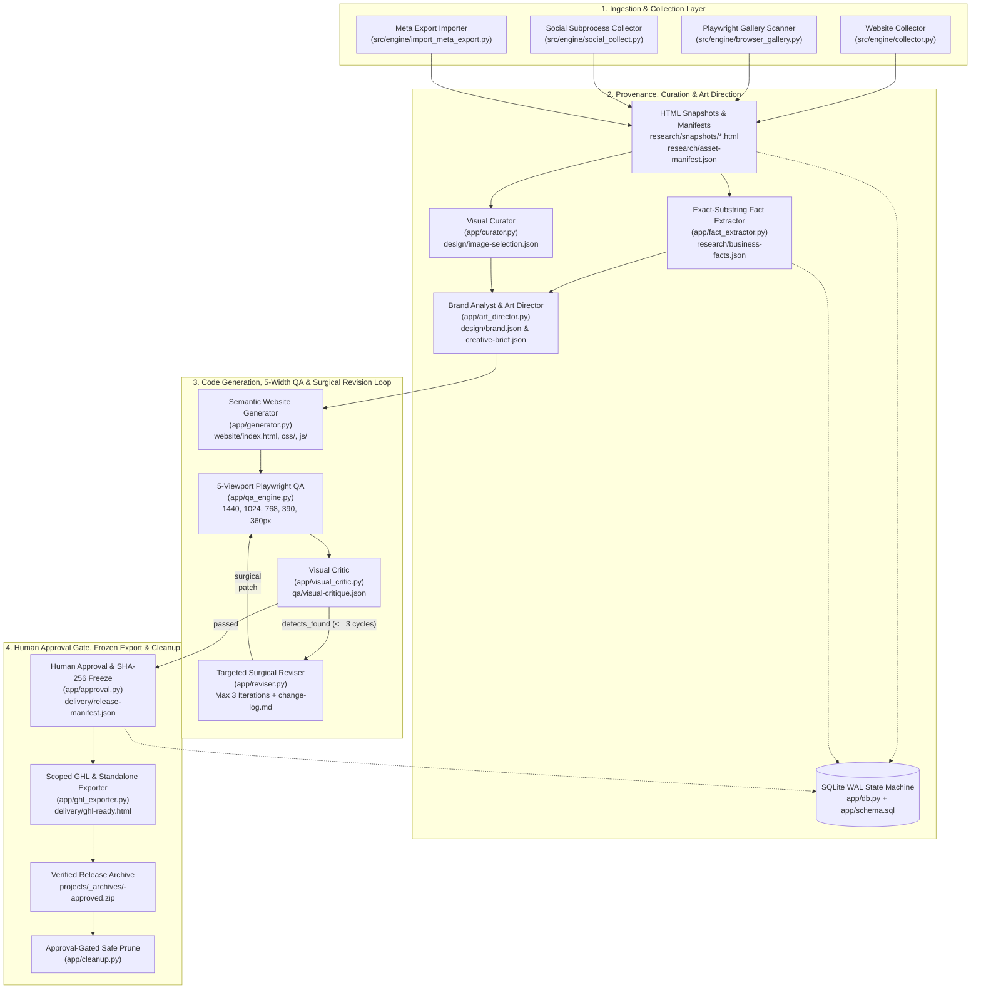
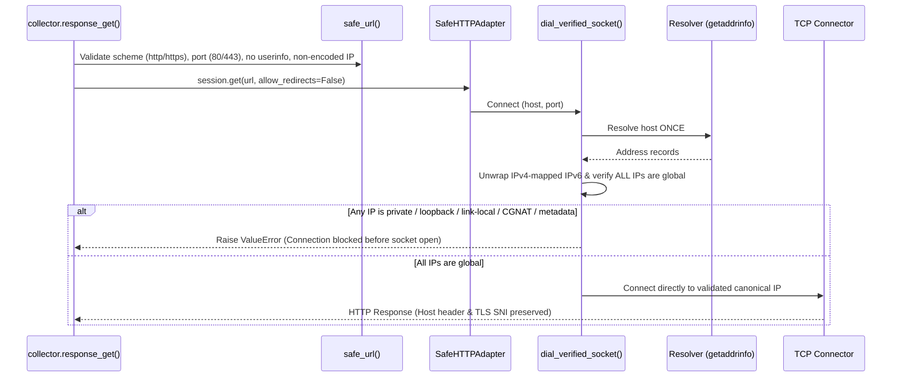

# Pet Grooming Website Builder Engine (`EditVista`)

[](https://github.com/rashidtesting8-ops/pet-gromming-agent-factory/actions/workflows/ci.yml)


**A local-first, provenance-enforced media collection, fact-verification, visual curation, art direction, semantic site generation, surgical revision, 5-viewport QA, and release-export engine for bespoke pet grooming websites.**

---

## Table of Contents

1. [Project Overview](#1-project-overview)
2. [Key Features](#2-key-features)
3. [Architecture & System Design](#3-architecture--system-design)
4. [Technology Stack](#4-technology-stack)
5. [Project Structure](#5-project-structure)
6. [Prerequisites](#6-prerequisites)
7. [Installation & Setup](#7-installation--setup)
8. [Environment Configuration](#8-environment-configuration)
9. [Usage & Examples](#9-usage--examples)
10. [API Documentation](#10-api-documentation)
11. [Testing & Quality Assurance](#11-testing--quality-assurance)
12. [Deployment & Production Considerations](#12-deployment--production-considerations)
13. [Security](#13-security)
14. [Troubleshooting](#14-troubleshooting)
15. [Roadmap](#15-roadmap)
16. [Contributing](#16-contributing)
17. [License & Acknowledgments](#17-license--acknowledgments)

---

## 1. Project Overview

### Purpose
The **Pet Grooming Website Builder Engine (`EditVista`)** is an evidence-preserving, modular Python backend and CLI pipeline that transforms a real pet grooming business's public website and authorized social media exports into a bespoke, responsive, accessible homepage. Every stage—from SSRF-hardened web collection and exact-substring fact verification to visual curation, art direction, semantic HTML5/CSS/JS synthesis, 5-viewport Playwright QA, surgical DOM revision, and human approval—is persisted atomically and verified by automated quality gates.

### Problem Statement
Conventional AI website generators frequently hallucinate prices, fabricate customer reviews, reuse unlicensed photos, remain vulnerable to indirect prompt injection from scraped HTML, overwrite entire layouts during minor revisions, and emit unscoped CSS/JS that breaks host page builders such as GoHighLevel.

### Core Value Proposition
- **Cryptographic Provenance & Zero Fabrication**: Every crawled webpage is archived to `research/snapshots/<sha256>.html`. Every extracted claim requires an exact substring match in the source snapshot; unverified prices or claims are automatically downgraded to `status="needs_review"` (`is_verified=False`) and rendered as inquiry CTAs rather than invented copy.
- **Defense-in-Depth Scraping**: A custom single-resolution socket dialer (`dial_verified_socket`) and scoped `SafeHTTPAdapter` eliminate DNS-rebinding TOCTOU windows and block all RFC 1918, loopback, link-local, CGNAT, and cloud-metadata IP ranges.
- **Bespoke Visual Curation & Art Direction**: Evaluates image resolution, sharpness, embedded promotional text, and upper-center pet focal coordinates (`object-position: X% Y%`), enforces zero duplicate image reuse across sections, extracts brand palettes (or falls back to an accessible navy/warm-amber/soft-sage palette), and tailors wireframes for mobile groomers vs. cat + dog salons.
- **Surgical Section-Level Revisions**: The visual critic and targeted revision engine (`app/visual_critic.py`, `app/reviser.py`) modify **only** the `<section id="...">` containers flagged with actionable defects while guaranteeing byte-for-byte SHA-256 preservation of all sibling sections (capped at 3 iterations before escalating to `review_needed`).
- **Mandatory Human Approval & Zero-Collision Host Embedding**: Deliverables are locked behind a human approval gate (`app/approval.py`) that freezes a deterministic SHA-256 release manifest (`delivery/release-manifest.json`), builds a verified `.zip` archive (`projects/_archives/<business-id>-approved.zip`), and exports a GoHighLevel custom code snippet (`delivery/ghl-ready.html`) scoped under `#ghl-ev-engine-root-[business_id]` with strict IIFE + `MutationObserver` JS isolation.

### Intended Audience & Use Cases
- **Internal EditVista Engineers & QA Operators**: Running resumable end-to-end site builds, reviewing side-by-side fact/asset/QA summaries, approving immutable releases, and executing approval-gated storage cleanup.
- **Workflow Automation Engineers**: Orchestrating collection and verification jobs via self-hosted n8n workflows and the local FastAPI + SQLite worker service.

---

## 2. Key Features

### Implemented Capabilities

| Capability | Module | Technical Implementation |
| :--- | :--- | :--- |
| **Master Resumable Pipeline & State Machine** | `app/pipeline.py` | Connects all 9 lifecycle stages with SQLite idempotency keys (`{project_id}_{stage_name}_{input_manifest_hash}`), `--resume` stage skipping, `--pause-for-approval` gate, and CLI subcommands (`approve`, `prune`). |
| **SSRF & DNS-Rebinding Hardened Crawler** | `src/engine/collector.py` | Crawls same-site pages (`<= 40`), obeys `robots.txt`, validates all resolved DNS records before connecting, archives raw HTML snapshots, strips `<script>`/`<style>`/`<iframe>`/`<noscript>`/`<svg>`/HTML comments, and neutralizes prompt-injection delimiters. |
| **Optional JS Gallery Discovery** | `src/engine/browser_gallery.py` | Renders JS-heavy gallery pages in an ephemeral headless Chromium context, extracts candidate media URLs, and downloads them through the same robots- and SSRF-guarded downloader. |
| **Hardened Subprocess Social Collector** | `src/engine/social_collect.py` | Invokes `gallery-dl` strictly as an external subprocess (`--config-ignore`, `--no-input`, `--sleep-request 3.0`, `--range 1-40`), executes a dry-run `--dump-json` pass to verify real post timestamps, strips EXIF/GPS metadata on optimized copies, and classifies failures (`login_required`, `rate_limited`, `extractor_broken`, `unknown`). |
| **Defensive Meta Export Importer** | `src/engine/import_meta_export.py` | Parses Instagram and Facebook `"Download your information"` `.zip` archives or folders across schema versions, repairs Latin-1/UTF-8 mojibake, enforces streaming byte/ratio caps against zip bombs, blocks path traversal, and uses real post timestamps for `captured_at` / `post_date`. |
| **Exact-Substring Fact Extractor** | `app/fact_extractor.py` | Extracts business name, phone, address, hours, grooming services, pricing tiers, and cancellation policies. Verifies each claim against exact substrings in sanitized snapshots and outputs `research/business-facts.json`. |
| **Visual Curator & Focal-Point Analyzer** | `app/curator.py` | Scans `assets/optimized/` and `assets/thumbnails/contact-sheet.jpg` with Pillow + pluggable LVM adapter; excludes low-res (`< 800px`) and baked-in text candidates; computes CSS `object-position` percentages; enforces zero duplicate assignment across `hero_image`, `grooming_gallery`, and `salon_facility_or_van` (`design/image-selection.json`). |
| **Brand Analyst & Art Director** | `app/art_director.py` | Extracts primary/secondary hex colors from verified logos (with accessible pet-care fallback: `#1B365D` navy, `#D98A2B` warm amber, `#8FA998` soft sage) and builds taxonomy-driven wireframes (`design/brand.json`, `design/creative-brief.json`). |
| **Semantic HTML5/CSS/JS Website Generator** | `app/generator.py` | Synthesizes responsive `<header>`, `<nav>`, `<main>`, `<section>`, `<footer>` markup, CSS custom properties with `clamp()` typography, and vanilla JS (mobile drawer + optional before/after slider) with zero external CDN dependencies. Renders inquiry CTAs when pricing is `needs_review`. |
| **Automated Visual Critic & Surgical Reviser** | `app/visual_critic.py`, `app/reviser.py` | Inspects 5-viewport screenshots and DOM/CSS for hero framing/contrast, cropped pet heads, flat beige repetitive cards (`#F5F5DC`), and spacing rhythm (`qa/visual-critique.json`). Surgically patches only flagged `<section id="...">` elements while keeping untouched sections byte-identical, logging diffs to `design/change-log.md` (max 3 iterations). |
| **5-Viewport Playwright QA Engine** | `app/qa_engine.py`, `src/engine/local_preview.py` | Spins up an ephemeral `http://localhost:<port>` server and inspects `1440px`, `1024px`, `768px`, `390px`, and `360px` viewports for horizontal overflow, HTTP 404s, broken images (`naturalWidth === 0`), console errors, placeholder CTA links, mobile-menu toggling, `prefers-reduced-motion`, and WCAG AA contrast ratios. |
| **Human Approval Package & Release Freeze** | `app/approval.py`, `src/engine/exporter.py`, `app/ghl_exporter.py` | Generates `qa/review-summary.json`, locks deliverable export until approved, computes deterministic SHA-256 checksum trees (`delivery/release-manifest.json`), scopes all GHL CSS under `#ghl-ev-engine-root-[business_id]`, wraps JS in a strict IIFE + `MutationObserver`, and compiles `projects/_archives/<business-id>-approved.zip`. |
| **Approval-Gated Cleanup & SQLite WAL Layer** | `app/cleanup.py`, `src/engine/cleanup.py`, `app/db.py` | Blocks pruning unless the verified `.zip` archive exists; preserves `delivery/` and `retained-assets.json`; enforces SQLite `WAL`, `busy_timeout=5000`, and `BEGIN IMMEDIATE` transactions. |
| **Local Job Queue API** | `src/engine/service.py` | FastAPI worker backed by SQLite state and a bounded semaphore (`4` slots, `2` worker threads); marks interrupted jobs as `interrupted` on restart. |

### Planned / Subsequent Milestones (Per `docs/DEVELOPER_BRIEF.md`)
- External multimodal LLM API adapter integration with disk response caching, token usage ledger, and per-job call caps (currently served by deterministic Pillow/DOM analyzers and injectable adapter callables).
- Five-business real-world acceptance pilot across live grooming salons, mobile vans, and daycares with live GoHighLevel page verification (Milestone 5).

---

## 3. Architecture & System Design

### End-to-End Lifecycle State Machine (`app/pipeline.py`)



### Network & SSRF Defense Flow (`collector.py`)



### Key Architectural Decisions
1. **Resumable Idempotency via Manifest Hashing**: Every stage in `app/pipeline.py` computes a SHA-256 digest over its input manifests (`compute_input_manifest_hash`) and queries `job_runs` with `idempotency_key = f"{project_id}_{stage_name}_{input_manifest_hash}"`. Completed stages with intact on-disk outputs are skipped on `--resume`.
2. **Byte-Identical Surgical Revisions**: `app/reviser.py` computes SHA-256 hashes of every `<section id="...">` block before and after patching (`compute_section_hashes`), modifying only sections flagged in `qa/visual-critique.json` and raising a runtime error if any untouched sibling section hash changes.
3. **Single-Resolution Dialing**: `dial_verified_socket` performs DNS resolution, validation of all returned A/AAAA records, and socket connection in one atomic step, eliminating DNS-rebinding TOCTOU windows.
4. **Write-Ahead Logging with Immediate Transactions**: `app/db.py` sets `isolation_level=None` and wraps all writes in `BEGIN IMMEDIATE` transactions with `PRAGMA busy_timeout = 5000`, preventing `SQLITE_BUSY` upgrade deadlocks under concurrent worker threads.

---

## 4. Technology Stack

| Category | Technology | Version / Constraint | Purpose |
| :--- | :--- | :--- | :--- |
| **Language & Runtime** | Python | `>=3.12,<3.13` | Core execution runtime |
| **Package & Env Manager** | `uv` / `hatchling` | `uv >= 0.9`, `hatchling >= 1.27` | Deterministic lockfile (`uv.lock`) and package build |
| **Data Validation** | Pydantic v2 | `>=2.10` (via FastAPI) | Stage contracts, database records, fact, curation, critique & QA schemas |
| **Web Scraping & HTML** | `requests`, `beautifulsoup4` | `>=2.31,<3`, `>=4.12,<5` | Static HTTP collection, DOM parsing, surgical section patching, markup sanitization |
| **Image Processing** | `Pillow` | `>=10,<13` | Resolution/sharpness analysis, focal-point centroid calculation, brand color quantization, EXIF stripping, contact sheets |
| **API & Worker Service** | `fastapi`, `uvicorn` | `>=0.115,<1`, `>=0.32,<1` | Local HTTP job queue service for n8n integration |
| **Database** | SQLite (`sqlite3`) | Python stdlib (WAL mode) | Durable job state, project registry, asset provenance, and business facts |
| **Browser Automation (Optional)** | `playwright` | `>=1.55,<2` (`==1.55.0` pinned) | Dynamic gallery discovery and 5-viewport QA rendering |
| **Social Extraction (Optional)** | `gallery-dl` | `>=1.30,<2` (`==1.30.0` pinned) | Subprocess-isolated public social media collection |
| **Workflow Orchestration** | n8n (Self-Hosted) | `docker.n8n.io/n8nio/n8n:2.39.5` | Sub-workflow job submission and polling via Docker Compose |
| **Linting, Typing & Testing** | `ruff`, `pyright`, `pytest` | `>=0.9`, `>=1.1.396`, `>=8.3` | Static analysis, type checking, and automated test suite |

---

## 5. Project Structure

```text
pet-gromming-agent-factory/
├── AGENTS.md                           # Non-negotiable domain & engineering rules
├── pyproject.toml                      # Python 3.12 packaging, dependencies, ruff/pyright/pytest config
├── uv.lock                             # Deterministic dependency lockfile
├── Makefile / justfile                 # Task runner targets (lint, typecheck, test)
├── Dockerfile                          # Python 3.12-slim container for FastAPI collector service
├── docker-compose.yml                  # Local n8n + collector service orchestration (127.0.0.1 bound)
├── requirements.txt                    # Core pip dependency pins
├── requirements-browser.txt            # Optional Playwright pin (playwright==1.55.0)
├── requirements-social.txt             # Optional gallery-dl pin (gallery-dl==1.30.0)
├── .github/workflows/ci.yml            # GitHub Actions CI pipeline (ruff, pyright, pytest on Ubuntu)
├── docs/
│   ├── DEVELOPER_BRIEF.md              # Full v1.1 system specification & milestone definitions
│   ├── HANDOFF_README.md               # Original developer handoff notes
│   ├── AUDIT_AND_TESTS.md              # Security & v2 collector audit log
│   └── BUDGET_AND_QUALITY.md           # Storage caps, model spend controls, and QA gates
├── examples/
│   └── BUSINESS_INPUT_EXAMPLE.json     # Example intake JSON payload
├── n8n/
│   ├── 01-submit-asset-research.json   # n8n webhook workflow to submit collection jobs
│   └── 02-check-asset-job.json         # n8n webhook workflow to poll job status
├── src/engine/
│   ├── __init__.py
│   ├── contracts/
│   │   └── __init__.py                 # Pydantic v2 models: StageInput, StageOutput, Asset, Claim, Warning
│   ├── collector.py                    # SSRF-hardened website crawler, HTML sanitizer & snapshot archiver
│   ├── browser_gallery.py              # Optional Playwright JS gallery candidate extractor
│   ├── social_collect.py               # Subprocess-only gallery-dl wrapper with EXIF stripping
│   ├── import_meta_export.py           # Instagram/Facebook export (.zip/folder) parser with zip-bomb guards
│   ├── import_social_media.py          # Manual client-provided social media importer
│   ├── contact_sheet.py                # Local JPEG contact-sheet generator for visual review
│   ├── local_preview.py                # 5-width static + Playwright preview QA (badLinks, menu, reduced-motion)
│   ├── exporter.py                     # Release exporter enforcing rights_confirmed_for_preview == True
│   ├── cleanup.py                      # Post-approval SHA-256 verified zip archiver & pruner
│   └── service.py                      # FastAPI + SQLite job service for n8n
├── app/
│   ├── schema.sql                      # Relational schema (projects, job_runs, asset_provenance, business_facts)
│   ├── db.py                           # SQLite WAL connection factory, BEGIN IMMEDIATE context, Pydantic models
│   ├── fact_extractor.py               # Exact-substring fact extractor writing research/business-facts.json
│   ├── curator.py                      # Pillow + LVM adapter visual curator writing design/image-selection.json
│   ├── art_director.py                 # Brand palette extractor & wireframe builder (brand.json, creative-brief.json)
│   ├── generator.py                    # Semantic HTML5/CSS/JS site generator writing website/index.html, css/, js/
│   ├── qa_engine.py                    # 5-viewport Playwright QA runner (WCAG AA contrast, 404s, overflow)
│   ├── visual_critic.py                # Automated visual critic writing actionable defects to qa/visual-critique.json
│   ├── reviser.py                      # Surgical section-level reviser (max 3 iterations) updating design/change-log.md
│   ├── approval.py                     # Human review summary, release gate, SHA-256 manifest freeze & ZIP archiver
│   ├── ghl_exporter.py                 # GoHighLevel exporter (#ghl-ev-engine-root-* CSS scoping + IIFE JS)
│   ├── pipeline.py                     # Master resumable CLI orchestrator & state machine (build, approve, prune)
│   ├── cleanup.py                      # Approval-gated safe_prune_project() & archive wrapper
│   └── collector.py ... service.py     # Re-export shims for src/engine/* modules
└── tests/
    ├── test_contracts.py               # StageInput/StageOutput, Asset, Claim, timezone & provenance tests
    ├── test_collector.py               # Website crawl, snapshot SHA-256, prompt-injection & fact extraction tests
    ├── test_db_concurrency.py          # SQLite PRAGMA verification, CRUD, and 10-thread concurrency tests
    ├── test_ssrf_rebinding.py          # 28 SSRF, IP literal encoding, redirect, and DNS-rebinding tests
    ├── test_curator_art_director.py    # Low-res/text exclusion, CSS focal percentages, brand palette & wireframes
    ├── test_critic_and_reviser.py      # Actionable visual defects, byte-identical sibling sections & 3-cycle cap
    ├── test_approval_archival.py       # Approval release gate, SHA-256 manifest freeze & safe staging prune
    ├── test_pipeline_e2e.py            # End-to-end ephemeral HTTP server pipeline & unverified-pricing CTA tests
    ├── test_pipeline_lifecycle.py      # Pipeline crash resumption (--resume), approval pause gate & CLI subcommands
    ├── test_local_preview.py           # Placeholder CTA link, mobile-menu, and reduced-motion QA tests
    ├── test_qa_engine.py               # 5-viewport Playwright QA, WCAG contrast, overflow & teardown tests
    ├── test_social_collect.py          # Dry-run metadata, EXIF/GPS stripping, and failure classification tests
    ├── test_import_meta_export.py      # Meta export parsing, zip-bomb, and path-traversal guard tests
    ├── test_exporter_release_gate.py   # Unconfirmed asset rights gate and deliverable generation tests
    ├── test_ghl_export.py              # CSS selector scoping, :root variable migration, and JS leakage tests
    └── test_v2.py                      # Core v2 regression suite (host validation, date cutoffs, cleanup)
```

---

## 6. Prerequisites

- **Operating System**: Linux, macOS, or Windows.
- **Python**: `3.12.x` (`>=3.12,<3.13` enforced in `pyproject.toml`).
- **Package Manager**: [`uv`](https://docs.astral.sh/uv/) (recommended) or standard `venv` + `pip`.
- **Database**: SQLite 3 (bundled with Python `sqlite3` standard library; supports WAL mode on local filesystems).
- **Optional Host Binaries**:
  - **Chromium via Playwright** (`playwright==1.55.0`): Required when running live headless browser rendering in `browser_gallery.py`, `local_preview.py`, or `qa_engine.py`.
  - **`gallery-dl`** (`gallery-dl==1.30.0`): Required when running live public social extraction via `social_collect.py`.
  - **Docker & Docker Compose**: Required when running the containerized `n8n` + `collector` service stack.

---

## 7. Installation & Setup

### Option A: Using `uv` (Recommended)

```bash
# 1. Clone the repository
git clone https://github.com/rashidtesting8-ops/pet-gromming-agent-factory.git
cd pet-gromming-agent-factory

# 2. Install Python 3.12 and sync locked dependencies (including dev tools)
uv python install 3.12
uv sync --frozen --dev

# 3. (Optional) Install Playwright and Chromium for live browser rendering
uv pip install -r requirements-browser.txt
uv run playwright install chromium

# 4. (Optional) Install gallery-dl for subprocess social media collection
uv pip install -r requirements-social.txt
```

### Option B: Using Standard `venv` + `pip`

```bash
python3.12 -m venv .venv
# Linux/macOS:
source .venv/bin/activate
# Windows PowerShell:
.venv\Scripts\Activate.ps1

pip install -r requirements.txt
```

### Initializing the SQLite Database Programmatically

```python
from pathlib import Path
from app.db import connect_db, init_db

conn = connect_db(Path("./projects/editvista.sqlite3"))
try:
    init_db(conn)  # Applies app/schema.sql inside a BEGIN IMMEDIATE transaction
finally:
    conn.close()
```

---

## 8. Environment Configuration

The engine runs locally without requiring external API keys. Containerized services use the following environment variables (configured in [`docker-compose.yml`](docker-compose.yml) and [`src/engine/service.py`](src/engine/service.py)):

| Variable | Description | Required | Default |
| :--- | :--- | :---: | :--- |
| `PROJECTS_DIR` | Filesystem directory where the FastAPI service stores crawled business projects and `_system/jobs.sqlite`. | No | `./projects` (local) / `/data/projects` (Docker) |
| `N8N_IMAGE` | Container image tag used for the self-hosted n8n service in `docker-compose.yml`. | No | `docker.n8n.io/n8nio/n8n:2.39.5` |
| `GENERIC_TIMEZONE` | Timezone used by the n8n container for cron and workflow timestamps. | No | `Asia/Karachi` |
| `TZ` | System timezone inside the n8n container. | No | `Asia/Karachi` |
| `N8N_ENFORCE_SETTINGS_FILE_PERMISSIONS` | Enforces strict file permissions on `/home/node/.n8n` inside the n8n container. | No | `true` |

---

## 9. Usage & Examples

### 9.1 Full Lifecycle Master Orchestrator (`app/pipeline.py`)
Runs the complete pipeline (`collect` -> `extract` -> `curate` -> `art_director` -> `generate` -> `qa` -> `critique` -> `revise`) and pauses at the human approval gate (`status="awaiting_approval"`):

```bash
# 1. Run pipeline and pause at human approval gate (default: --pause-for-approval)
uv run python -m app.pipeline \
  --url https://example-groomer.com \
  --name "Bark & Bliss Pet Grooming" \
  --business-id bark-and-bliss

# 2. Resume an interrupted or failed build (skips already-completed SQLite stages)
uv run python -m app.pipeline \
  --url https://example-groomer.com \
  --name "Bark & Bliss Pet Grooming" \
  --business-id bark-and-bliss \
  --resume

# 3. Approve & freeze release (writes release-manifest.json, ghl-ready.html, and approved.zip)
uv run python -m app.pipeline approve \
  --project-id bark-and-bliss \
  --operator "Dev" \
  --notes "Verified facts, asset rights, and 5-viewport QA"

# 4. Run approval-gated cleanup (dry-run first, then --execute)
uv run python -m app.pipeline prune --project-id bark-and-bliss
uv run python -m app.pipeline prune --project-id bark-and-bliss --execute
```

### 9.2 Individual Stage Execution Examples

#### Website Collection & Exact-Substring Fact Extraction
```bash
uv run python -m app.collector https://example-groomer.com \
  --output ./projects \
  --max-pages 25 \
  --max-media 80
```

```python
from pathlib import Path
from app.fact_extractor import extract_business_facts

report = extract_business_facts(Path("./projects/example-groomer-com"))
print(f"Extracted {len(report.facts)} facts; verified={sum(f.is_verified for f in report.facts)}")
```

#### Visual Curation, Art Direction & Semantic Website Generation
```python
from pathlib import Path
from app.curator import curate_project_images
from app.art_director import generate_art_direction
from app.generator import generate_website

project = Path("./projects/example-groomer-com")
selection = curate_project_images(project)          # -> design/image-selection.json
brand, brief = generate_art_direction(project)      # -> design/brand.json & creative-brief.json
bundle = generate_website(project)                  # -> website/index.html, css/styles.css, js/main.js
```

#### Visual Critic & Surgical Section Revision Loop
```python
from pathlib import Path
from app.reviser import run_critique_revision_loop

project = Path("./projects/example-groomer-com")
loop_res = run_critique_revision_loop(project)      # Max 3 cycles; updates design/change-log.md
print(loop_res.final_status, loop_res.modified_sections_history)
```

#### Public Social Media Collection & Meta Export Import
```bash
# Subprocess gallery-dl collection (requires --i-have-permission)
uv run python -m app.social_collect \
  --project ./projects/example-groomer-com \
  --platform instagram \
  --url https://www.instagram.com/example_groomer/ \
  --max-files 40 \
  --days 365 \
  --i-have-permission

# Import Meta "Download your information" ZIP/folder export
uv run python -m app.import_meta_export \
  --project ./projects/example-groomer-com \
  --export ./exports/instagram-export.zip \
  --platform auto \
  --max-files 80
```

#### 5-Viewport Playwright QA & Scoped GoHighLevel Export
```bash
# Run 5-viewport Playwright QA (1440, 1024, 768, 390, 360px)
uv run python -m app.qa_engine \
  --project ./projects/example-groomer-com \
  --html website/index.html

# Export scoped GoHighLevel snippet (#ghl-ev-engine-root-*)
uv run python -m app.ghl_exporter \
  --project ./projects/example-groomer-com \
  --business-id example-groomer-com
```

---

## 10. API Documentation

The local FastAPI worker ([`src/engine/service.py`](src/engine/service.py)) exposes a private HTTP API bound to `127.0.0.1:8787` for n8n workflow orchestration. No authentication header is required because the service is bound strictly to the host loopback interface (`127.0.0.1`).

### Start the API Server Locally

```bash
uv run uvicorn app.service:app --host 127.0.0.1 --port 8787
```

### Endpoints

#### 1. `GET /health`
- **Purpose**: Liveness check for Docker and n8n.
- **Response (`200 OK`)**:
  ```json
  {
    "ok": true
  }
  ```

#### 2. `POST /jobs`
- **Purpose**: Validate target URL via `safe_url()` and enqueue an asynchronous website collection job.
- **Request Body (`application/json`)**:
  ```json
  {
    "url": "https://example-groomer.com",
    "max_pages": 25,
    "max_media": 80
  }
  ```
  - `url` (`string`, required): Public `http://` or `https://` website URL on port `80` or `443`.
  - `max_pages` (`integer`, optional, default `25`): Must be between `1` and `40`.
  - `max_media` (`integer`, optional, default `80`): Must be between `1` and `120`.
- **Success Response (`202 Accepted`)**:
  ```json
  {
    "job_id": "9f8c2b1a4e7d4c3b8a1f0e9d8c7b6a5f",
    "status": "queued"
  }
  ```
- **Error Responses**:
  - `400 Bad Request`: URL failed SSRF or scheme/port validation.
  - `422 Unprocessable Entity`: `max_pages` or `max_media` outside allowed bounds.
  - `429 Too Many Requests`: All 4 semaphore queue slots are currently occupied (`"Collector busy; retry later"`).

#### 3. `GET /jobs/{job_id}`
- **Purpose**: Retrieve the durable SQLite status and output summary of a submitted job.
- **Success Response (`200 OK`)**:
  ```json
  {
    "job_id": "9f8c2b1a4e7d4c3b8a1f0e9d8c7b6a5f",
    "status": "done",
    "result": {
      "site_url": "https://example-groomer.com",
      "pages_crawled": 6,
      "assets_saved": 14,
      "project_folder": "projects/example-groomer-com"
    }
  }
  ```
  - Possible `status` values: `"queued"`, `"running"`, `"done"`, `"failed"`, `"interrupted"`.
- **Error Response**:
  - `404 Not Found`: `"Unknown job"`.

---

## 11. Testing & Quality Assurance

Every change is gated by three verification tools configured in [`pyproject.toml`](pyproject.toml) and [`.github/workflows/ci.yml`](.github/workflows/ci.yml):

```bash
# Run linter, static type checker, and all 88 tests in one command
uv run ruff check . && uv run pyright && uv run pytest -v
```

Using `Makefile` or `justfile`:

```bash
make lint        # uv run ruff check .
make typecheck   # uv run pyright
make test        # uv run pytest
```

### Test Suite Breakdown (88 Automated Tests Across 16 Modules)

| Test File | Count | Coverage Focus |
| :--- | :---: | :--- |
| `tests/test_ssrf_rebinding.py` | 28 | RFC 1918 private IPs, loopback (`127.0.0.1`, `::1`), IPv4-mapped IPv6 (`::ffff:127.0.0.1`), link-local/cloud metadata (`169.254.169.254`), CGNAT (`100.64.0.0/10`), octal/hex/integer IP literals, redirect blocking to `127.0.0.1` and `http://n8n:5678`, multi-record DNS rejection, and single-resolution DNS rebinding defense. |
| `tests/test_contracts.py` | 10 | Pydantic v2 validation for `StageInput`, `StageOutput`, `Asset`, `Claim`, and `Warning`; timezone-aware datetime enforcement; non-empty `source_text`; `rights_confirmed_for_preview=False` default. |
| `tests/test_social_collect.py` | 10 | `--i-have-permission` enforcement, dry-run `--dump-json` timestamp parsing, EXIF/GPS stripping on optimized images, corrupt image rejection, and failure classification (`login_required`, `rate_limited`, `extractor_broken`, `unknown`). |
| `tests/test_collector.py` | 5 | End-to-end local HTTP crawl, HTML snapshot SHA-256 verification, `<script>`/`<style>`/`<iframe>`/`<noscript>`/`<svg>`/comment stripping, prompt-injection neutralization, exact-substring fact extraction, and `3.0s` social sleep rate limits. |
| `tests/test_v2.py` | 4 | Social hostname spoofing prevention, leap-year date cutoffs, runner limits, path-traversal protection in retention manifests, and verified archive/prune workflow. |
| `tests/test_approval_archival.py` | 3 | Blocks deliverable export and cleanup when unapproved or archive is missing; verifies `release-manifest.json` SHA-256 tree changes when HTML/CSS is modified; ensures `retained-assets.json` and `delivery/` are never touched during prune. |
| `tests/test_critic_and_reviser.py` | 3 | Actionable visual defect generation, rejection of vague feedback (`"make it better"`), byte-identical SHA-256 preservation of untouched sibling `<section>` nodes, incremental `change-log.md` updates, and 3-iteration loop cap (`review_needed`). |
| `tests/test_curator_art_director.py` | 3 | Exclusion of low-res (`< 800px`) and baked-in promotional text hero candidates, valid CSS percentage focal coordinates (`object-position`), cross-section deduplication, brand color extraction/fallback, and mobile vs. cat+dog wireframes. |
| `tests/test_db_concurrency.py` | 3 | SQLite PRAGMA verification (`WAL`, `busy_timeout=5000`, `NORMAL`, `foreign_keys=ON`, `MEMORY`), Pydantic v2 CRUD round-trips, and 10 concurrent writer threads executing 15 multi-table `BEGIN IMMEDIATE` transactions each with zero lock errors. |
| `tests/test_exporter_release_gate.py` | 3 | Blocks release when any used asset has `rights_confirmed_for_preview=False` or is missing from manifests; builds deliverables when all used assets are confirmed. |
| `tests/test_ghl_export.py` | 3 | `#ghl-ev-engine-root-*` CSS selector scoping, `:root` custom property migration, markup wrapper stripping, IIFE + `MutationObserver` isolation, and `window.*`/`document.*` global leakage rejection. |
| `tests/test_import_meta_export.py` | 3 | Instagram & Facebook export parsing across schema versions, idempotent SHA-256 deduplication, zip-bomb ratio/stream caps, and `../` path traversal blocking. |
| `tests/test_local_preview.py` | 3 | Fails `technical_pass` on `#`, empty, `javascript:`, or placeholder CTA/nav links; verifies mobile menu open/close and `prefers-reduced-motion: reduce`. |
| `tests/test_qa_engine.py` | 3 | WCAG 2.1 contrast ratio math, 5-breakpoint (`1440`, `1024`, `768`, `390`, `360px`) Playwright inspection, defect reporting, and deterministic `finally:` teardown of pages, contexts, and browsers. |
| `tests/test_pipeline_e2e.py` | 2 | Full end-to-end pipeline run against an ephemeral HTTP grooming salon server and inquiry CTA fallback when pricing is `needs_review`. |
| `tests/test_pipeline_lifecycle.py` | 2 | Simulated crash after curation with `--resume` stage skipping (`collect`, `extract`, `curate` skipped) and `--pause-for-approval` gate followed by `approve` and `prune --execute` CLI subcommands. |

---

## 12. Deployment & Production Considerations

### Verified Docker Compose Setup (`n8n` + `collector`)
[`docker-compose.yml`](docker-compose.yml) runs two resource-bounded containers bound strictly to `127.0.0.1`:
- **`n8n`** (`127.0.0.1:5678:5678`, `mem_limit: 1g`): Self-hosted workflow orchestrator persisting state in the `n8n_data` named volume.
- **`collector`** (`127.0.0.1:8787:8787`, `mem_limit: 512m`): Built from [`Dockerfile`](Dockerfile) (`python:3.12-slim`), mounting `./projects` to `/data/projects`.

```bash
# Build and start both services in the background
docker compose up --build -d

# View collector service logs
docker compose logs -f collector
```

After starting the containers:
1. Open `http://localhost:5678` and import [`n8n/01-submit-asset-research.json`](n8n/01-submit-asset-research.json) and [`n8n/02-check-asset-job.json`](n8n/02-check-asset-job.json).
2. Submit a research job via webhook:
   ```bash
   curl -X POST http://localhost:5678/webhook/pet-grooming-research \
     -H "Content-Type: application/json" \
     -d '{"url": "https://example-groomer.com"}'
   ```

### Operational & Resource Bounds
- **Storage Quotas**: Website media collection is capped at `140 MB` per run (`MAX_SITE_BYTES`); social staging is capped at `150 MB` (`MAX_STAGING_BYTES`), `25 MB` per file (`MAX_ITEM_BYTES`), and `300 MB` total project size (`MAX_PROJECT_BYTES`).
- **SQLite Filesystem Placement**: Keep SQLite databases (`jobs.sqlite`, `editvista.sqlite3`) on local POSIX or NTFS disks. Do not place SQLite WAL databases on NFS or SMB network shares, where OS file-locking semantics can corrupt WAL shared-memory (`-shm`) files.

---

## 13. Security

- **Zero Credential Harvesting or Bypass**: The engine never collects platform credentials, never reads browser cookies (`--config-ignore`, `--no-input`), never evades CAPTCHAs, and never rotates identities.
- **SSRF & Internal Network Isolation**: All outbound collector requests pass through `dial_verified_socket`, which blocks private, loopback, link-local, multicast, CGNAT, and cloud metadata (`169.254.169.254`) endpoints on initial connection and every redirect hop.
- **Prompt Injection Defense**: External HTML and social captions are treated strictly as untrusted data. `collect_page_text` decomposes executable/hidden DOM nodes (`script`, `style`, `iframe`, `noscript`, `svg`, `object`, `embed`, `template`, and HTML comments) and strips lines matching known prompt-injection delimiters before downstream fact extraction.
- **Archive & Path Traversal Protection**: Both `import_meta_export.py` and `cleanup.py` resolve candidate paths and verify `Path.is_relative_to(root)`, rejecting symlinks, absolute paths, and `..` traversal segments.
- **Privacy & EXIF Sanitization**: Downloaded social and exported images are re-encoded via `strip_image_metadata()` into `assets/optimized/` with all EXIF orientation and GPS location tags removed.

---

## 14. Troubleshooting

| Symptom / Error | Root Cause | Resolution |
| :--- | :--- | :--- |
| `status: "review_needed", reason: "permission_required"` in `social_collect` | CLI or `collect_social()` was invoked without explicit permission confirmation. | Pass `--i-have-permission` on the CLI or `i_have_permission=True` in Python after confirming reuse review scope. |
| `status: "review_needed", reason: "gallery_dl_not_installed"` | Optional `gallery-dl` binary is not installed in the active environment. | Run `uv pip install -r requirements-social.txt`. |
| `ReleaseApprovalGateError: Deliverable export is locked` | `export_approved_deliverables` was called before human approval or without a valid `approval_token`. | Inspect `qa/review-summary.json` and run `uv run python -m app.pipeline approve --project-id <ID> --operator "<Name>"`. |
| `ValueError: Pruning is strictly BLOCKED: verified archive ... does not exist` | `safe_prune_project` or `cleanup --mode prune` was called before freezing an approved release archive. | Approve the release (`python -m app.pipeline approve ...`) or build the verified archive (`python -m app.cleanup --mode archive`) first. |
| `status: "blocked_unconfirmed_rights"` in `exporter.py` | One or more assets referenced in `website/index.html` have `rights_confirmed_for_preview: false` or are missing from the manifest. | Inspect `result["offending_assets"]`, verify client permission for each listed file, and set `rights_confirmed_for_preview: true` in the manifest only after human confirmation. |
| `GlobalLeakageError` in `ghl_exporter.py` | Website JavaScript assigns properties directly to `window.*`, `document.*`, or `globalThis.*`. | Refactor scripts in `website/js/` to keep state inside local variables scoped to the IIFE and query elements via the provided `root` container. |
| `RuntimeError: Install requirements-browser.txt and Chromium` | Playwright or the Chromium browser binary is missing. | Run `uv pip install -r requirements-browser.txt && uv run playwright install chromium`. |

---

## 15. Roadmap

Per [`docs/DEVELOPER_BRIEF.md`](docs/DEVELOPER_BRIEF.md), the project follows five sequential milestones:

- [x] **Milestone 1 — Collect & Prove Provenance**: Hardened website collector, HTML snapshot archiving, SSRF/DNS-rebinding defense, hardened `gallery-dl` wrapper, Meta export importer, contact sheet builder, and SQLite WAL data layer.
- [x] **Milestone 2 — Visual & Content Intelligence**: Exact-substring fact extractor (`app/fact_extractor.py`), Pillow + LVM adapter visual curator (`app/curator.py`), brand analyst & art director (`app/art_director.py`), and Pydantic v2 contracts (`src/engine/contracts/`).
- [x] **Milestone 3 — Design, Critique, QA & Surgical Revision Loop**: Semantic HTML5/CSS/JS website generator (`app/generator.py`), 5-viewport Playwright QA runner (`app/qa_engine.py`), automated visual critic (`app/visual_critic.py`), and surgical section-level reviser (`app/reviser.py`) with 3-cycle cap.
- [x] **Milestone 4 — Human Approval, Frozen Release Export & Cleanup**: Resumable pipeline orchestrator (`app/pipeline.py`), human review summary & SHA-256 release freeze (`app/approval.py`), scoped GoHighLevel snippet exporter (`app/ghl_exporter.py`), and approval-gated archive/prune (`app/cleanup.py`).
- [ ] **Milestone 5 — Five-Business Acceptance Pilot**: End-to-end validation across five real pet grooming businesses (salon, mobile, daycare) with live HighLevel embed verification and external multimodal LLM adapter benchmarking.

---

## 16. Contributing

All contributions must adhere strictly to [`AGENTS.md`](AGENTS.md):

1. **Read the Spec First**: Review [`AGENTS.md`](AGENTS.md) and [`docs/DEVELOPER_BRIEF.md`](docs/DEVELOPER_BRIEF.md) before writing code.
2. **Test-Driven Development (TDD)**: Write a failing test in `tests/` first, then implement the minimal code required to make it pass.
3. **No Unapproved Dependencies**: Do not add new packages to `pyproject.toml` without explicit justification and version pinning.
4. **Atomic File Operations**: Write all JSON manifests, snapshots, and HTML deliverables using a temporary file in the target directory followed by `os.replace()`.
5. **Mandatory Pre-Commit Verification**: Run and verify zero errors from all three checks before committing:
   ```bash
   uv run ruff check . && uv run pyright && uv run pytest
   ```

---

## 17. License & Acknowledgments

- **License**: Internal / Proprietary — **EditVista** prototype and testing project (not licensed for public redistribution; see [`AGENTS.md`](AGENTS.md) and [`docs/DEVELOPER_BRIEF.md`](docs/DEVELOPER_BRIEF.md)).
- **Acknowledgments**: Built with Python 3.12, [FastAPI](https://fastapi.tiangolo.com/), [Pydantic v2](https://docs.pydantic.dev/), [BeautifulSoup4](https://www.crummy.com/software/BeautifulSoup/), [Pillow](https://python-pillow.org/), [Playwright](https://playwright.dev/python/), [gallery-dl](https://github.com/mikf/gallery-dl), [n8n](https://n8n.io/), and [uv](https://docs.astral.sh/uv/).
