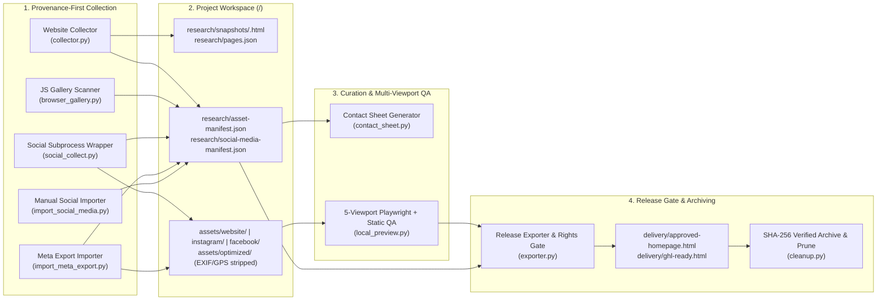

# Pet Grooming Website Builder Engine

[](https://github.com/rashidtesting8-ops/pet-gromming-agent-factory/actions/workflows/ci.yml)


A local-first, provenance-enforced, security-hardened asset collection, verification, QA, and release-export engine for **EditVista's Pet Grooming Website Builder**.

Designed around strict factual provenance and defense-in-depth engineering: **no fabricated business facts, no unverified claims, no unconfirmed asset rights in deliverables, and zero hosting cost for local preview and multi-viewport QA.**

---

## Table of Contents

1. [Core Engineering & Domain Invariants](#1-core-engineering--domain-invariants)
2. [System Architecture & Pipeline](#2-system-architecture--pipeline)
3. [Repository Layout](#3-repository-layout)
4. [Security & Hardening Architecture](#4-security--hardening-architecture)
5. [Quickstart (`uv` + Python 3.12)](#5-quickstart-uv--python-312)
6. [Module & CLI Reference](#6-module--cli-reference)
7. [Data Contracts & Project Workspace Schema](#7-data-contracts--project-workspace-schema)
8. [n8n & Docker Orchestration](#8-n8n--docker-orchestration)
9. [Quality Gates, Testing & CI](#9-quality-gates-testing--ci)

---

## 1. Core Engineering & Domain Invariants

Every component in `src/engine/` enforces the non-negotiable rules defined in [`AGENTS.md`](AGENTS.md) and [`docs/DEVELOPER_BRIEF.md`](docs/DEVELOPER_BRIEF.md):

| Invariant | Enforcement Mechanism |
| :--- | :--- |
| **Zero Fabrication** | Missing or unsupported business facts, prices, services, or reviews are marked `status="needs_review"`—never invented. |
| **Untrusted External Input** | All scraped HTML, social captions, and image metadata are treated strictly as **data**, never executable instructions. |
| **Claim Provenance** | Every [`Claim`](src/engine/contracts/__init__.py) requires `source_url`, non-empty `source_text`, `snapshot_sha256`, `verified`, `status`, and timezone-aware `last_checked_at`. Raw HTML snapshots are archived at `research/snapshots/<sha256>.html`. |
| **Asset Provenance & Rights Gate** | Every [`Asset`](src/engine/contracts/__init__.py) records `source_url`, `sha256`, timezone-aware `captured_at`, and defaults to `rights_confirmed_for_preview=False`. |
| **Mandatory Exporter Release Gate** | [`exporter.py`](src/engine/exporter.py) refuses to build `delivery/approved-homepage.html` or `delivery/ghl-ready.html` if **any** referenced asset has `rights_confirmed_for_preview != True` or is missing from manifests, returning the full list of offending assets. |
| **Immutable Releases** | Once exported under `delivery/`, approved releases cannot be overwritten (`status="blocked_immutable_release"`). |
| **Atomic & Idempotent I/O** | Manifests, snapshots, and deliverables are written via temporary files + `os.replace` and deduplicated by `sha256`. |

---

## 2. System Architecture & Pipeline



---

## 3. Repository Layout

```text
pet-gromming-agent-factory/
├── AGENTS.md                         # Non-negotiable domain & engineering rules
├── pyproject.toml                    # Python 3.12 + uv config, pinned deps, ruff/pyright/pytest
├── uv.lock                           # Deterministic dependency lockfile
├── Makefile / justfile               # Developer task shortcuts (lint, typecheck, test)
├── Dockerfile / docker-compose.yml   # Local n8n + FastAPI collector service containers
├── requirements*.txt                 # Compatibility requirement pins (core, social, browser)
├── .github/workflows/ci.yml          # GitHub Actions CI (ruff + pyright + pytest)
├── docs/
│   ├── DEVELOPER_BRIEF.md            # Full technical architecture & milestone specification
│   ├── HANDOFF_README.md             # Developer handoff guide
│   ├── AUDIT_AND_TESTS.md            # Security & validation audit log
│   └── BUDGET_AND_QUALITY.md         # Resource bounds, spend caps, and QA criteria
├── examples/
│   └── BUSINESS_INPUT_EXAMPLE.json   # Canonical business intake payload
├── n8n/
│   ├── 01-submit-asset-research.json # Starter n8n job submission workflow
│   └── 02-check-asset-job.json       # Starter n8n job polling workflow
├── src/engine/
│   ├── contracts/
│   │   └── __init__.py               # Pydantic v2 models: StageInput, StageOutput, Asset, Claim, Warning
│   ├── collector.py                  # SSRF/rebinding-hardened website crawler & snapshot archiver
│   ├── browser_gallery.py            # Optional Playwright JS gallery candidate discovery
│   ├── social_collect.py             # Hardened gallery-dl subprocess wrapper + EXIF/GPS stripper
│   ├── import_meta_export.py         # Defensive Meta "Download your information" zip/folder importer
│   ├── import_social_media.py        # Client-authorized media registration utility
│   ├── contact_sheet.py              # Thumbnail grid contact-sheet builder for visual curation
│   ├── local_preview.py              # 5-width Playwright + static link/menu/reduced-motion QA
│   ├── exporter.py                   # Standalone HTML + scoped GHL snippet exporter with rights gate
│   ├── cleanup.py                    # Post-approval CRC/SHA-256 verified zip archiver & pruner
│   └── service.py                    # Local FastAPI + SQLite job queue for n8n orchestration
├── app/                              # Backward-compatible CLI/module shims re-exporting src/engine/*
└── tests/
    ├── test_contracts.py             # Pydantic v2 contract validation tests
    ├── test_collector.py             # Website crawl, HTML snapshot SHA-256, and asset provenance tests
    ├── test_ssrf_rebinding.py        # 28 SSRF, IP encoding, redirect, and DNS-rebinding tests
    ├── test_local_preview.py         # Bad/placeholder CTA link, mobile-menu, and reduced-motion QA tests
    ├── test_social_collect.py        # Subprocess dry-run metadata, EXIF/GPS strip, failure classification tests
    ├── test_import_meta_export.py    # Instagram/Facebook export parsing, zip-bomb & traversal guard tests
    ├── test_exporter_release_gate.py # Release gate blocking unconfirmed/missing assets & GHL export tests
    └── test_v2.py                    # Core v2 regression suite (hosts, date limits, archive/prune)
```

---

## 4. Security & Hardening Architecture

### 4.1 SSRF & DNS Rebinding Protection ([`src/engine/collector.py`](src/engine/collector.py))
- **Single-Resolution Verified Dialer ([`dial_verified_socket`](src/engine/collector.py))**: Resolves DNS **once** per connection via an injectable resolver, unwraps IPv4-mapped IPv6 addresses (`::ffff:127.0.0.1`), and rejects the connection if **any** returned address is private, loopback, link-local, multicast, unspecified (`0.0.0.0`), CGNAT (`100.64.0.0/10`), cloud metadata (`169.254.169.254`), or non-global—eliminating the TOCTOU window between URL validation and socket connect.
- **Scoped Adapter ([`SafeHTTPAdapter`](src/engine/collector.py))**: Attached exclusively to the collector's `requests.Session` (no global `urllib3` monkeypatching) while preserving the original hostname for `Host` header, TLS SNI, and certificate verification.
- **Manual Redirect Validation**: `session.trust_env = False` (ignores ambient proxy env vars) and `allow_redirects = False`; every redirect hop (`<= MAX_REDIRECT_HOPS`) is re-validated against scheme (`http`/`https`), port (`80`/`443`), userinfo, and DNS/IP rules.

### 4.2 Hardened Optional Social Collector ([`src/engine/social_collect.py`](src/engine/social_collect.py))
- **Subprocess Isolation**: `gallery-dl` (`==1.30.0` in [`requirements-social.txt`](requirements-social.txt)) runs strictly as a child process (`shell=False`, `stdin=DEVNULL`) and is never imported.
- **Explicit Permission Gate**: Requires `--i-have-permission` on the CLI (`i_have_permission=True`); otherwise returns `status="review_needed", reason="permission_required"`.
- **Two-Phase Dry-Run Metadata Verification**:
  1. Runs `gallery-dl --dump-json` first to inspect post metadata (`date`, `post_date`, `timestamp`, `post_url`, `username`).
  2. Derives `post_date` in our own parser and sets `post_date_verified=True` **only** when a real timestamp exists in metadata.
- **Zero Credential / Cookie Leakage**: Always passes `--config-ignore` and `--no-input`; scrubs sensitive tokens from logs via [`scrub_sensitive_text`](src/engine/social_collect.py).
- **EXIF & GPS Stripping ([`strip_image_metadata`](src/engine/social_collect.py))**: Every downloaded image is verified with Pillow and re-encoded into `assets/optimized/` with all EXIF/GPS tags stripped.
- **Deterministic Failure Classification ([`classify_social_failure`](src/engine/social_collect.py))**: Classifies failures into `login_required`, `rate_limited`, `extractor_broken`, or `unknown` -> `status="review_needed"`, never raising unhandled exceptions to the caller.

### 4.3 Defensive Meta Export Importer ([`src/engine/import_meta_export.py`](src/engine/import_meta_export.py))
- **Zip-Bomb & Stream Caps**: Never calls `ZipFile.extractall()`. Enforces `max_zip_entries`, `max_item_bytes`, `max_total_bytes`, and `max_compression_ratio` while streaming decompressed chunks so spoofed zip headers cannot bypass limits.
- **Path Traversal & Symlink Guards**: Rejects zip symlinks, absolute paths, drive letters, and `..` segments in both archive member filenames and JSON `uri` references (`Path.is_relative_to` verification).
- **Schema-Resilient Parsing**: Handles Instagram and Facebook `"Download your information"` JSON variations across versions, repairs Meta's Latin-1/UTF-8 mojibake strings, ignores unknown fields, and logs all unparseable files or records to `research/meta-export-import-log.json`.

### 4.4 Technical Preview QA & Exporter Release Gate
- **Technical QA ([`src/engine/local_preview.py`](src/engine/local_preview.py))**: Renders across 5 viewports (`1440`, `1024`, `768`, `390`, `360px`) and fails `technical_pass` if any CTA or nav link is `#`, empty, `javascript:`, or a placeholder (`todo`, `placeholder`, `coming-soon`, `example.com`), or if mobile-menu open/close or `prefers-reduced-motion: reduce` support is broken.
- **Exporter Rights Gate ([`src/engine/exporter.py`](src/engine/exporter.py))**: Inspects all assets referenced in HTML/CSS before building `delivery/approved-homepage.html` and `delivery/ghl-ready.html`. Any asset with `rights_confirmed_for_preview=False` (or missing from manifests) halts the release and returns `offending_assets`.

---

## 5. Quickstart (`uv` + Python 3.12)

```bash
# 1. Install dependencies into isolated .venv
uv sync

# 2. Run linter, static type checker, and test suite
uv run ruff check .
uv run pyright
uv run pytest -v
```

Or using `Makefile` / `justfile`:

```bash
make lint
make typecheck
make test
```

---

## 6. Module & CLI Reference

### 6.1 Website Collector (`collector.py`)
Crawls a public grooming website, archives raw HTML snapshots to `research/snapshots/<sha256>.html`, records page metadata in `research/pages.json`, and downloads verified site media into `assets/website/`.

```bash
uv run python -m engine.collector https://example-groomer.com --output ./projects --max-pages 25 --max-media 80
```

### 6.2 Optional Social Collector (`social_collect.py`)
Runs `gallery-dl` as a bounded subprocess with dry-run metadata extraction and EXIF/GPS stripping.

```bash
uv run python -m engine.social_collect \
  --project ./projects/example-groomer-com \
  --platform instagram \
  --url https://www.instagram.com/example_groomer/ \
  --max-files 40 \
  --days 365 \
  --i-have-permission
```

### 6.3 Meta Export Importer (`import_meta_export.py`)
Imports an Instagram or Facebook `"Download your information"` `.zip` archive or extracted folder into `research/asset-manifest.json` and `research/social-media-manifest.json`.

```bash
uv run python -m engine.import_meta_export \
  --project ./projects/example-groomer-com \
  --export ./exports/instagram-export.zip \
  --platform auto \
  --max-files 80
```

### 6.4 Local Preview & Multi-Viewport Technical QA (`local_preview.py`)
Runs 5-viewport QA checks (broken images, horizontal overflow, bad/placeholder CTA/nav links, mobile menu open/close, and `prefers-reduced-motion`).

```bash
uv run python -m engine.local_preview --html ./projects/example-groomer-com/website/index.html
```

### 6.5 Contact Sheet Generator (`contact_sheet.py`)
Builds a visual contact sheet of collected photos for human/vision curation.

```bash
uv run python -m engine.contact_sheet --project ./projects/example-groomer-com
```

### 6.6 Standalone & GoHighLevel Release Exporter (`exporter.py`)
Verifies that every used asset has `rights_confirmed_for_preview=True` and exports `delivery/approved-homepage.html`, `delivery/ghl-ready.html`, `delivery/retained-assets.json`, and `delivery/release-manifest.json`.

```bash
uv run python -m engine.exporter --project ./projects/example-groomer-com
```

### 6.7 Post-Approval Archive & Storage Cleanup (`cleanup.py`)
Creates a CRC/SHA-256 verified zip backup of all retained delivery and research files before pruning unused staging assets.

```bash
uv run python -m engine.cleanup --project ./projects/example-groomer-com --mode plan
uv run python -m engine.cleanup --project ./projects/example-groomer-com --mode archive
uv run python -m engine.cleanup --project ./projects/example-groomer-com --mode prune --confirm
```

---

## 7. Data Contracts & Project Workspace Schema

All stage boundaries are typed with Pydantic v2 models in [`src/engine/contracts/__init__.py`](src/engine/contracts/__init__.py):

- **`StageInput`**: `{project_id, run_id, input_manifest_version, paths[]}`
- **`StageOutput`**: `{status, outputs, warnings[], errors[], checksums{}}`
- **`Asset`**: `{asset_id, source_url, page_url, local_path, sha256, width, height, mime, captured_at, rights_confirmed_for_preview=False, category, notes}`
- **`Claim`**: `{field, value, source_url, source_text, snapshot_sha256, verified, status, last_checked_at}`

Each business project directory follows a deterministic layout under `projects/<business-slug>/`:

```text
projects/<business-slug>/
├── assets/
│   ├── website/                      # Raw website media
│   ├── instagram/                    # Raw Instagram media
│   ├── facebook/                     # Raw Facebook media
│   └── optimized/                    # EXIF/GPS-stripped optimized images
├── research/
│   ├── snapshots/<sha256>.html       # Immutable raw HTML snapshots for claim verification
│   ├── pages.json                    # Crawled page metadata (url, sha256, fetched_at, status_code)
│   ├── asset-manifest.json           # Unified asset provenance manifest
│   ├── social-media-manifest.json    # Social media provenance & post_date verification manifest
│   ├── meta-export-import-log.json   # Defensive import log & unparsed item report
│   └── run-summary.json              # Collector run telemetry
├── website/
│   └── index.html                    # Candidate standalone website under QA/revision
├── qa/
│   ├── screenshots/                  # 1440w, 1024w, 768w, 390w, 360w viewport renders
│   └── qa-report.json                # Structured technical & visual QA report
└── delivery/                         # Immutable post-approval release artifacts
    ├── approved-homepage.html        # Standalone HTML deliverable
    ├── ghl-ready.html                # Scoped GoHighLevel custom HTML/CSS/JS snippet
    ├── asset-manifest.json           # Approved subset of asset provenance records
    ├── retained-assets.json          # Explicit retention list for cleanup gate
    └── release-manifest.json         # Release timestamp and SHA-256 checksums
```

---

## 8. n8n & Docker Orchestration

Start the local n8n orchestrator and FastAPI collector worker (`127.0.0.1` bound):

```bash
docker compose up --build -d
```

- **n8n UI**: `http://localhost:5678` (import [`n8n/01-submit-asset-research.json`](n8n/01-submit-asset-research.json) and [`n8n/02-check-asset-job.json`](n8n/02-check-asset-job.json))
- **Collector Service OpenAPI Docs**: `http://localhost:8787/docs`

---

## 9. Quality Gates, Testing & CI

Every change must pass the three-stage verification gate configured in [`.github/workflows/ci.yml`](.github/workflows/ci.yml):

```bash
uv run ruff check . && uv run pyright && uv run pytest
```

- **`ruff`**: Enforces `E`, `F`, `I`, `B`, `UP` rules at `line-length = 100` targeting Python 3.12.
- **`pyright`**: Runs static type analysis across `src/` and `tests/` (`0 errors, 0 warnings`).
- **`pytest`**: Runs 63 automated unit and integration tests covering contracts, HTML snapshot provenance, SSRF/DNS rebinding defense, social collection hardening, Meta export parsing/zip-bomb guards, multi-viewport preview QA, exporter release gates, and verified archive cleanup.
