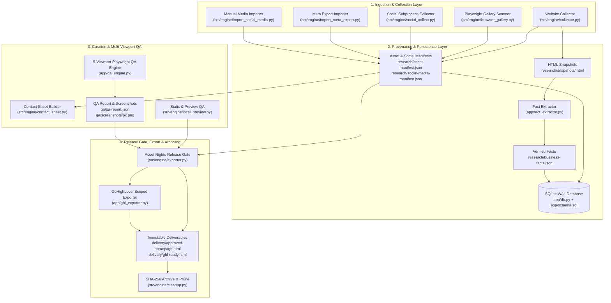
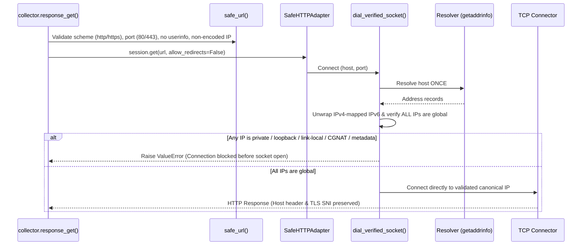

# Pet Grooming Website Builder Engine 

[](https://github.com/rashidtesting8-ops/pet-gromming-agent-factory/actions/workflows/ci.yml)


**A local-first, provenance-enforced media collection, fact-verification, multi-viewport QA, and release-export engine for bespoke pet grooming websites.**

---

## Table of Contents

1. [Project Overview](#1-project-overview)
2. [Key Features](#2-key-features)
3. [Architecture & System Design](#3-architecture--system-design)
4. [Technology Stack](#4-technology-stack)
5. [Project Structure](#5-project-structure)
6. [Prerequisites](#6-prerequisites)
7. [Installation & Setup](#7-installation--setup)
8. [Environment Configuration](#8-environment-configuration)
9. [Usage & Examples](#9-usage--examples)
10. [API Documentation](#10-api-documentation)
11. [Testing & Quality Assurance](#11-testing--quality-assurance)
12. [Deployment & Production Considerations](#12-deployment--production-considerations)
13. [Security](#13-security)
14. [Troubleshooting](#14-troubleshooting)
15. [Roadmap](#15-roadmap)
16. [Contributing](#16-contributing)
17. [License & Acknowledgments](#17-license--acknowledgments)

---

## 1. Project Overview

### Purpose
The **Pet Grooming Website Builder Engine (`EditVista`)** is an evidence-preserving backend and CLI toolkit that ingests a real pet grooming business's public website and authorized social media exports, verifies every business fact and media asset against cryptographic snapshots, runs automated 5-viewport visual/technical QA, and exports approved designs as both standalone HTML and scoped GoHighLevel (GHL) custom code snippets.

### Problem Statement
Conventional AI website generators frequently hallucinate prices, fabricate customer reviews, reuse unlicensed photos, remain vulnerable to indirect prompt injection from scraped HTML, and emit unscoped CSS/JS that breaks host page builders such as GoHighLevel.

### Core Value Proposition
- **Cryptographic Provenance**: Every crawled webpage is archived to `research/snapshots/<sha256>.html`. Every extracted claim requires an exact substring match in the source snapshot; unverified prices or claims are automatically downgraded to `status="needs_review"` (`is_verified=False`).
- **Defense-in-Depth Scraping**: A custom single-resolution socket dialer (`dial_verified_socket`) and scoped `SafeHTTPAdapter` eliminate DNS-rebinding TOCTOU windows and block all RFC 1918, loopback, link-local, CGNAT, and cloud-metadata IP ranges.
- **Mandatory Release Gates**: Deliverables cannot be built unless every referenced asset in the HTML/CSS has `rights_confirmed_for_preview=True` in the project manifests. Approved releases under `delivery/` are immutable.
- **Zero-Collision Host Embedding**: The GoHighLevel exporter strips document wrapper tags, prefixes every CSS selector under `#ghl-ev-engine-root-[business_id]`, migrates `:root` custom properties, and isolates JavaScript inside a strict IIFE with a `MutationObserver` mount fallback.

### Intended Audience & Use Cases
- **Internal EditVista Engineers & QA Operators**: Running bounded research collection, verifying client asset rights, executing 5-width viewport inspections, and generating immutable standalone + GoHighLevel release packages.
- **Workflow Automation Engineers**: Orchestrating collection and verification jobs via self-hosted n8n workflows and the local FastAPI + SQLite worker service.

---

## 2. Key Features

### Implemented Capabilities

| Capability | Module | Technical Implementation |
| :--- | :--- | :--- |
| **SSRF & DNS-Rebinding Hardened Crawler** | `src/engine/collector.py` | Crawls same-site pages (`<= 40`), obeys `robots.txt`, validates all resolved DNS records before connecting, archives raw HTML snapshots, strips `<script>`/`<style>`/`<iframe>`/`<noscript>`/`<svg>`/HTML comments, and neutralizes prompt-injection delimiters. |
| **Optional JS Gallery Discovery** | `src/engine/browser_gallery.py` | Renders JS-heavy gallery pages in an ephemeral headless Chromium context, extracts candidate media URLs, and downloads them through the same robots- and SSRF-guarded downloader. |
| **Hardened Subprocess Social Collector** | `src/engine/social_collect.py` | Invokes `gallery-dl` strictly as an external subprocess (`--config-ignore`, `--no-input`, `--sleep-request 3.0`, `--range 1-40`), executes a dry-run `--dump-json` pass to verify real post timestamps, strips EXIF/GPS metadata on optimized copies, and classifies failures (`login_required`, `rate_limited`, `extractor_broken`, `unknown`). |
| **Defensive Meta Export Importer** | `src/engine/import_meta_export.py` | Parses Instagram and Facebook `"Download your information"` `.zip` archives or folders across schema versions, repairs Latin-1/UTF-8 mojibake, enforces streaming byte/ratio caps against zip bombs, blocks path traversal, and uses real post timestamps for `captured_at` / `post_date`. |
| **Exact-Substring Fact Extractor** | `app/fact_extractor.py` | Extracts business name, phone, address, hours, grooming services, pricing tiers, and cancellation policies. Verifies each claim against exact substrings in sanitized snapshots and outputs `research/business-facts.json`. |
| **SQLite WAL Data Access Layer** | `app/db.py`, `app/schema.sql` | Configures `journal_mode=WAL`, `busy_timeout=5000`, `synchronous=NORMAL`, `foreign_keys=ON`, and `temp_store=MEMORY` on every connection; provides `immediate_transaction` (`BEGIN IMMEDIATE`) and Pydantic v2 models for `projects`, `job_runs`, `asset_provenance`, and `business_facts`. |
| **5-Viewport Playwright QA Engine** | `app/qa_engine.py`, `src/engine/local_preview.py` | Spins up an ephemeral `http://localhost:<port>` server and inspects `1440px`, `1024px`, `768px`, `390px`, and `360px` viewports for horizontal overflow, HTTP 404s, broken images (`naturalWidth === 0`), console errors, placeholder CTA links, mobile-menu toggling, `prefers-reduced-motion`, and WCAG AA contrast ratios. |
| **Release Gate & GoHighLevel Exporter** | `src/engine/exporter.py`, `app/ghl_exporter.py` | Blocks export if any referenced asset has `rights_confirmed_for_preview=False`; scopes all CSS selectors under `#ghl-ev-engine-root-[business_id]`; wraps JS in a strict IIFE + `MutationObserver`; prohibits `window.*`/`document.*` global leakage. |
| **Verified Archive & Selective Cleanup** | `src/engine/cleanup.py` | Builds a CRC- and SHA-256-verified `.zip` backup in `projects/_archives/` before pruning unused staging media (`--mode plan`, `archive`, `prune --confirm`). |
| **Local Job Queue API** | `src/engine/service.py` | FastAPI worker backed by SQLite state and a bounded semaphore (`4` slots, `2` worker threads); marks interrupted jobs as `interrupted` on restart. |

### Planned / Subsequent Milestones (Per `docs/DEVELOPER_BRIEF.md`)
- Vision-model curation agent, brand analyst, art director, and creative-brief generator (Milestone 2).
- Automated website designer/coder and visual critic targeted revision loop (Milestone 3).
- Human approval web UI and 5-business end-to-end acceptance pilot (Milestones 4–5).

---

## 3. Architecture & System Design

### End-to-End Pipeline Architecture



### Network & SSRF Defense Flow (`collector.py`)



### Key Architectural Decisions
1. **Path Passing Over Payload Passing**: Stages exchange file paths and SHA-256 checksums (`StageInput` / `StageOutput`), never passing raw multi-megabyte media bytes through orchestrator payloads.
2. **Single-Resolution Dialing**: Instead of resolving DNS in a URL validator and letting `urllib3` resolve DNS a second time during `connect()`, `dial_verified_socket` performs resolution, validation of all returned A/AAAA records, and socket connection in one atomic step.
3. **Manual Redirect Traversal**: Automatic redirects in `requests` are disabled (`allow_redirects=False`); each redirect hop (`<= 5`) is re-validated through `safe_url` and `dial_verified_socket`.
4. **Write-Ahead Logging with Immediate Transactions**: `app/db.py` sets `isolation_level=None` and wraps all writes in `BEGIN IMMEDIATE` transactions with `PRAGMA busy_timeout = 5000`, preventing `SQLITE_BUSY` upgrade deadlocks under concurrent worker threads.

---

## 4. Technology Stack

| Category | Technology | Version / Constraint | Purpose |
| :--- | :--- | :--- | :--- |
| **Language & Runtime** | Python | `>=3.12,<3.13` | Core execution runtime |
| **Package & Env Manager** | `uv` / `hatchling` | `uv >= 0.9`, `hatchling >= 1.27` | Deterministic lockfile (`uv.lock`) and package build |
| **Data Validation** | Pydantic v2 | `>=2.10` (via FastAPI) | Stage contracts, database records, fact & QA schemas |
| **Web Scraping & HTML** | `requests`, `beautifulsoup4` | `>=2.31,<3`, `>=4.12,<5` | Static HTTP collection, DOM parsing, markup sanitization |
| **Image Processing** | `Pillow` | `>=10,<13` | Image verification, dimension inspection, EXIF/GPS stripping, contact sheets |
| **API & Worker Service** | `fastapi`, `uvicorn` | `>=0.115,<1`, `>=0.32,<1` | Local HTTP job queue service for n8n integration |
| **Database** | SQLite (`sqlite3`) | Python stdlib (WAL mode) | Durable job state, project registry, asset provenance, and business facts |
| **Browser Automation (Optional)** | `playwright` | `>=1.55,<2` (`==1.55.0` pinned) | Dynamic gallery discovery and 5-viewport QA rendering |
| **Social Extraction (Optional)** | `gallery-dl` | `>=1.30,<2` (`==1.30.0` pinned) | Subprocess-isolated public social media collection |
| **Workflow Orchestration** | n8n (Self-Hosted) | `docker.n8n.io/n8nio/n8n:2.39.5` | Sub-workflow job submission and polling via Docker Compose |
| **Linting, Typing & Testing** | `ruff`, `pyright`, `pytest` | `>=0.9`, `>=1.1.396`, `>=8.3` | Static analysis, type checking, and automated test suite |

---

## 5. Project Structure

```text
pet-gromming-agent-factory/
├── AGENTS.md                           # Non-negotiable domain & engineering rules
├── pyproject.toml                      # Python 3.12 packaging, dependencies, ruff/pyright/pytest config
├── uv.lock                             # Deterministic dependency lockfile
├── Makefile / justfile                 # Task runner targets (lint, typecheck, test)
├── Dockerfile                          # Python 3.12-slim container for FastAPI collector service
├── docker-compose.yml                  # Local n8n + collector service orchestration (127.0.0.1 bound)
├── requirements.txt                    # Core pip dependency pins
├── requirements-browser.txt            # Optional Playwright pin (playwright==1.55.0)
├── requirements-social.txt             # Optional gallery-dl pin (gallery-dl==1.30.0)
├── .github/workflows/ci.yml            # GitHub Actions CI pipeline (ruff, pyright, pytest on Ubuntu)
├── docs/
│   ├── DEVELOPER_BRIEF.md              # Full v1.1 system specification & milestone definitions
│   ├── HANDOFF_README.md               # Original developer handoff notes
│   ├── AUDIT_AND_TESTS.md              # Security & v2 collector audit log
│   └── BUDGET_AND_QUALITY.md           # Storage caps, model spend controls, and QA gates
├── examples/
│   └── BUSINESS_INPUT_EXAMPLE.json     # Example intake JSON payload
├── n8n/
│   ├── 01-submit-asset-research.json   # n8n webhook workflow to submit collection jobs
│   └── 02-check-asset-job.json         # n8n webhook workflow to poll job status
├── src/engine/
│   ├── __init__.py
│   ├── contracts/
│   │   └── __init__.py                 # Pydantic v2 models: StageInput, StageOutput, Asset, Claim, Warning
│   ├── collector.py                    # SSRF-hardened website crawler, HTML sanitizer & snapshot archiver
│   ├── browser_gallery.py              # Optional Playwright JS gallery candidate extractor
│   ├── social_collect.py               # Subprocess-only gallery-dl wrapper with EXIF stripping
│   ├── import_meta_export.py           # Instagram/Facebook export (.zip/folder) parser with zip-bomb guards
│   ├── import_social_media.py          # Manual client-provided social media importer
│   ├── contact_sheet.py                # Local JPEG contact-sheet generator for visual review
│   ├── local_preview.py                # 5-width static + Playwright preview QA (badLinks, menu, reduced-motion)
│   ├── exporter.py                     # Release exporter enforcing rights_confirmed_for_preview == True
│   ├── cleanup.py                      # Post-approval SHA-256 verified zip archiver & pruner
│   └── service.py                      # FastAPI + SQLite job service for n8n
├── app/
│   ├── schema.sql                      # Relational schema (projects, job_runs, asset_provenance, business_facts)
│   ├── db.py                           # SQLite WAL connection factory, BEGIN IMMEDIATE context, Pydantic models
│   ├── fact_extractor.py               # Exact-substring fact extractor writing research/business-facts.json
│   ├── qa_engine.py                    # 5-viewport Playwright QA runner (WCAG AA contrast, 404s, overflow)
│   ├── ghl_exporter.py                 # GoHighLevel exporter (#ghl-ev-engine-root-* CSS scoping + IIFE JS)
│   ├── collector.py                    # Re-export shim for src/engine/collector.py
│   ├── browser_gallery.py              # Re-export shim for src/engine/browser_gallery.py
│   ├── social_collect.py               # Re-export shim for src/engine/social_collect.py
│   ├── import_meta_export.py           # Re-export shim for src/engine/import_meta_export.py
│   ├── import_social_media.py          # Re-export shim for src/engine/import_social_media.py
│   ├── contact_sheet.py                # Re-export shim for src/engine/contact_sheet.py
│   ├── local_preview.py                # Re-export shim for src/engine/local_preview.py
│   ├── exporter.py                     # Re-export shim for src/engine/exporter.py
│   ├── cleanup.py                      # Re-export shim for src/engine/cleanup.py
│   └── service.py                      # Re-export shim for src/engine/service.py
└── tests/
    ├── test_contracts.py               # StageInput/StageOutput, Asset, Claim, timezone & provenance tests
    ├── test_collector.py               # Website crawl, snapshot SHA-256, prompt-injection & fact extraction tests
    ├── test_db_concurrency.py          # SQLite PRAGMA verification, CRUD, and 10-thread concurrency tests
    ├── test_ssrf_rebinding.py          # 28 SSRF, IP literal encoding, redirect, and DNS-rebinding tests
    ├── test_local_preview.py           # Placeholder CTA link, mobile-menu, and reduced-motion QA tests
    ├── test_qa_engine.py               # 5-viewport Playwright QA, WCAG contrast, overflow & teardown tests
    ├── test_social_collect.py          # Dry-run metadata, EXIF/GPS stripping, and failure classification tests
    ├── test_import_meta_export.py      # Meta export parsing, zip-bomb, and path-traversal guard tests
    ├── test_exporter_release_gate.py   # Unconfirmed asset rights gate and deliverable generation tests
    ├── test_ghl_export.py              # CSS selector scoping, :root variable migration, and JS leakage tests
    └── test_v2.py                      # Core v2 regression suite (host validation, date cutoffs, cleanup)
```

---

## 6. Prerequisites

- **Operating System**: Linux, macOS, or Windows.
- **Python**: `3.12.x` (`>=3.12,<3.13` enforced in `pyproject.toml`).
- **Package Manager**: [`uv`](https://docs.astral.sh/uv/) (recommended) or standard `venv` + `pip`.
- **Database**: SQLite 3 (bundled with Python `sqlite3` standard library; supports WAL mode on local filesystems).
- **Optional Host Binaries**:
  - **Chromium via Playwright** (`playwright==1.55.0`): Required only when running live browser rendering in `browser_gallery.py`, `local_preview.py`, or `qa_engine.py`.
  - **`gallery-dl`** (`gallery-dl==1.30.0`): Required only when running live public social extraction via `social_collect.py`.
  - **Docker & Docker Compose**: Required only when running the containerized `n8n` + `collector` service stack.

---

## 7. Installation & Setup

### Option A: Using `uv` (Recommended)

```bash
# 1. Clone the repository
git clone https://github.com/rashidtesting8-ops/pet-gromming-agent-factory.git
cd pet-gromming-agent-factory

# 2. Install Python 3.12 and sync locked dependencies (including dev tools)
uv python install 3.12
uv sync --frozen --dev

# 3. (Optional) Install Playwright and Chromium for live browser rendering
uv pip install -r requirements-browser.txt
uv run playwright install chromium

# 4. (Optional) Install gallery-dl for subprocess social media collection
uv pip install -r requirements-social.txt
```

### Option B: Using Standard `venv` + `pip`

```bash
python3.12 -m venv .venv
# Linux/macOS:
source .venv/bin/activate
# Windows PowerShell:
.venv\Scripts\Activate.ps1

pip install -r requirements.txt
```

### Initializing the SQLite Database Programmatically

```python
from pathlib import Path
from app.db import connect_db, init_db

conn = connect_db(Path("./projects/_system/editvista.sqlite"))
try:
    init_db(conn)  # Applies app/schema.sql inside a BEGIN IMMEDIATE transaction
finally:
    conn.close()
```

---

## 8. Environment Configuration

The engine runs locally without requiring external API keys. Containerized services use the following environment variables (configured in [`docker-compose.yml`](docker-compose.yml) and [`src/engine/service.py`](src/engine/service.py)):

| Variable | Description | Required | Default |
| :--- | :--- | :---: | :--- |
| `PROJECTS_DIR` | Filesystem directory where the FastAPI service stores crawled business projects and `_system/jobs.sqlite`. | No | `./projects` (local) / `/data/projects` (Docker) |
| `N8N_IMAGE` | Container image tag used for the self-hosted n8n service in `docker-compose.yml`. | No | `docker.n8n.io/n8nio/n8n:2.39.5` |
| `GENERIC_TIMEZONE` | Timezone used by the n8n container for cron and workflow timestamps. | No | `Asia/Karachi` |
| `TZ` | System timezone inside the n8n container. | No | `Asia/Karachi` |
| `N8N_ENFORCE_SETTINGS_FILE_PERMISSIONS` | Enforces strict file permissions on `/home/node/.n8n` inside the n8n container. | No | `true` |

---

## 9. Usage & Examples

### 9.1 Crawl a Business Website & Archive HTML Snapshots
Crawls up to `max-pages` same-site URLs, saves raw HTML snapshots to `research/snapshots/<sha256>.html`, strips unsafe tags and prompt-injection strings, and downloads site media to `assets/website/`.

```bash
uv run python -m app.collector https://example-groomer.com \
  --output ./projects \
  --max-pages 25 \
  --max-media 80
```

### 9.2 Extract & Verify Business Facts Against HTML Snapshots
Parses business name, phone, address, hours, grooming services, pricing tiers, and cancellation policies from crawled snapshots and writes `research/business-facts.json`:

```python
from pathlib import Path
from app.fact_extractor import extract_business_facts

report = extract_business_facts(Path("./projects/example-groomer-com"))
print(f"Extracted {len(report.facts)} facts; verified={sum(f.is_verified for f in report.facts)}")
```

### 9.3 Collect Public Social Media (Subprocess-Isolated `gallery-dl`)
Requires the explicit `--i-have-permission` flag. Runs a dry-run `--dump-json` metadata pass first, enforces a `3.0s` sleep between requests, caps downloads at `40` files within a `365`-day window, and strips EXIF/GPS metadata into `assets/optimized/`:

```bash
uv run python -m app.social_collect \
  --project ./projects/example-groomer-com \
  --platform instagram \
  --url https://www.instagram.com/example_groomer/ \
  --max-files 40 \
  --days 365 \
  --i-have-permission
```

### 9.4 Import a Meta "Download Your Information" Archive
Safely parses an Instagram or Facebook export (`.zip` or folder) into `research/asset-manifest.json` and `research/social-media-manifest.json` with zip-bomb and path-traversal guards:

```bash
uv run python -m app.import_meta_export \
  --project ./projects/example-groomer-com \
  --export ./exports/instagram-export.zip \
  --platform auto \
  --max-files 80
```

### 9.5 Generate a Visual Contact Sheet

```bash
uv run python -m app.contact_sheet --project ./projects/example-groomer-com
```

### 9.6 Run Automated 5-Viewport QA (`1440px`, `1024px`, `768px`, `390px`, `360px`)
Starts an ephemeral local HTTP server, inspects all 5 breakpoints for horizontal overflow, 404s, broken images, console errors, and WCAG AA contrast compliance, saves `<width>px.png` screenshots, and writes `qa/qa-report.json`:

```bash
uv run python -m app.qa_engine \
  --project ./projects/example-groomer-com \
  --html website/index.html
```

To run static + preview link/menu/reduced-motion QA directly on an HTML file:

```bash
uv run python -m app.local_preview --html ./projects/example-groomer-com/website/index.html
```

### 9.7 Export Standalone HTML & Scoped GoHighLevel Deliverables
Verifies that every asset referenced in `website/index.html` has `rights_confirmed_for_preview=True` before writing `delivery/approved-homepage.html` and `delivery/ghl-ready.html`:

```bash
uv run python -m app.exporter --project ./projects/example-groomer-com
```

To generate the CSS-scoped (`#ghl-ev-engine-root-[business_id]`), IIFE-isolated GoHighLevel custom code snippet directly from `website/index.html`, `website/css/*.css`, and `website/js/*.js`:

```bash
uv run python -m app.ghl_exporter \
  --project ./projects/example-groomer-com \
  --business-id example-groomer-com
```

### 9.8 Post-Approval Verified Archive & Storage Cleanup

```bash
# 1. Inspect removable staging files and reclaimable bytes
uv run python -m app.cleanup --project ./projects/example-groomer-com --mode plan

# 2. Build CRC + SHA-256 verified zip archive in projects/_archives/
uv run python -m app.cleanup --project ./projects/example-groomer-com --mode archive

# 3. Prune unretained raw assets (requires verified archive + --confirm)
uv run python -m app.cleanup --project ./projects/example-groomer-com --mode prune --confirm
```

---

## 10. API Documentation

The local FastAPI worker ([`src/engine/service.py`](src/engine/service.py)) exposes a private HTTP API bound to `127.0.0.1:8787` for n8n workflow orchestration. No authentication header is required because the service is bound strictly to the host loopback interface (`127.0.0.1`).

### Start the API Server Locally

```bash
uv run uvicorn app.service:app --host 127.0.0.1 --port 8787
```

### Endpoints

#### 1. `GET /health`
- **Purpose**: Liveness check for Docker and n8n.
- **Response (`200 OK`)**:
  ```json
  {
    "ok": true
  }
  ```

#### 2. `POST /jobs`
- **Purpose**: Validate target URL via `safe_url()` and enqueue an asynchronous website collection job.
- **Request Body (`application/json`)**:
  ```json
  {
    "url": "https://example-groomer.com",
    "max_pages": 25,
    "max_media": 80
  }
  ```
  - `url` (`string`, required): Public `http://` or `https://` website URL on port `80` or `443`.
  - `max_pages` (`integer`, optional, default `25`): Must be between `1` and `40`.
  - `max_media` (`integer`, optional, default `80`): Must be between `1` and `120`.
- **Success Response (`202 Accepted`)**:
  ```json
  {
    "job_id": "9f8c2b1a4e7d4c3b8a1f0e9d8c7b6a5f",
    "status": "queued"
  }
  ```
- **Error Responses**:
  - `400 Bad Request`: URL failed SSRF or scheme/port validation.
  - `422 Unprocessable Entity`: `max_pages` or `max_media` outside allowed bounds.
  - `429 Too Many Requests`: All 4 semaphore queue slots are currently occupied (`"Collector busy; retry later"`).

#### 3. `GET /jobs/{job_id}`
- **Purpose**: Retrieve the durable SQLite status and output summary of a submitted job.
- **Success Response (`200 OK`)**:
  ```json
  {
    "job_id": "9f8c2b1a4e7d4c3b8a1f0e9d8c7b6a5f",
    "status": "done",
    "result": {
      "site_url": "https://example-groomer.com",
      "pages_crawled": 6,
      "assets_saved": 14,
      "project_folder": "projects/example-groomer-com"
    }
  }
  ```
  - Possible `status` values: `"queued"`, `"running"`, `"done"`, `"failed"`, `"interrupted"`.
- **Error Response**:
  - `404 Not Found`: `"Unknown job"`.

---

## 11. Testing & Quality Assurance

Every change is gated by three verification tools configured in [`pyproject.toml`](pyproject.toml) and [`.github/workflows/ci.yml`](.github/workflows/ci.yml):

```bash
# Run linter, static type checker, and all 75 tests in one command
uv run ruff check . && uv run pyright && uv run pytest -v
```

Using `Makefile` or `justfile`:

```bash
make lint        # uv run ruff check .
make typecheck   # uv run pyright
make test        # uv run pytest
```

### Test Suite Breakdown (75 Automated Tests)

| Test File | Count | Coverage Focus |
| :--- | :---: | :--- |
| `tests/test_ssrf_rebinding.py` | 28 | RFC 1918 private IPs, loopback (`127.0.0.1`, `::1`), IPv4-mapped IPv6 (`::ffff:127.0.0.1`), link-local/cloud metadata (`169.254.169.254`), CGNAT (`100.64.0.0/10`), octal/hex/integer IP literals, redirect blocking to `127.0.0.1` and `http://n8n:5678`, multi-record DNS rejection, and single-resolution DNS rebinding defense. |
| `tests/test_contracts.py` | 10 | Pydantic v2 validation for `StageInput`, `StageOutput`, `Asset`, `Claim`, and `Warning`; timezone-aware datetime enforcement; non-empty `source_text`; `rights_confirmed_for_preview=False` default. |
| `tests/test_social_collect.py` | 10 | `--i-have-permission` enforcement, dry-run `--dump-json` timestamp parsing, EXIF/GPS stripping on optimized images, corrupt image rejection, and failure classification (`login_required`, `rate_limited`, `extractor_broken`, `unknown`). |
| `tests/test_collector.py` | 5 | End-to-end local HTTP crawl, HTML snapshot SHA-256 verification, `<script>`/`<style>`/`<iframe>`/`<noscript>`/`<svg>`/comment stripping, prompt-injection neutralization, exact-substring fact extraction, and `3.0s` social sleep rate limits. |
| `tests/test_v2.py` | 4 | Social hostname spoofing prevention, leap-year date cutoffs, runner limits, path-traversal protection in retention manifests, and verified archive/prune workflow. |
| `tests/test_db_concurrency.py` | 3 | SQLite PRAGMA verification (`WAL`, `busy_timeout=5000`, `NORMAL`, `foreign_keys=ON`, `MEMORY`), Pydantic v2 CRUD round-trips, and 10 concurrent writer threads executing 15 multi-table `BEGIN IMMEDIATE` transactions each with zero lock errors. |
| `tests/test_exporter_release_gate.py` | 3 | Blocks release when any used asset has `rights_confirmed_for_preview=False` or is missing from manifests; builds deliverables when all used assets are confirmed. |
| `tests/test_ghl_export.py` | 3 | `#ghl-ev-engine-root-*` CSS selector scoping, `:root` custom property migration, markup wrapper stripping, IIFE + `MutationObserver` isolation, and `window.*`/`document.*` global leakage rejection. |
| `tests/test_import_meta_export.py` | 3 | Instagram & Facebook export parsing across schema versions, idempotent SHA-256 deduplication, zip-bomb ratio/stream caps, and `../` path traversal blocking. |
| `tests/test_local_preview.py` | 3 | Fails `technical_pass` on `#`, empty, `javascript:`, or placeholder CTA/nav links; verifies mobile menu open/close and `prefers-reduced-motion: reduce`. |
| `tests/test_qa_engine.py` | 3 | WCAG 2.1 contrast ratio math, 5-breakpoint (`1440`, `1024`, `768`, `390`, `360px`) Playwright inspection, defect reporting, and deterministic `finally:` teardown of pages, contexts, and browsers. |

---

## 12. Deployment & Production Considerations

### Verified Docker Compose Setup (`n8n` + `collector`)
[`docker-compose.yml`](docker-compose.yml) runs two resource-bounded containers bound strictly to `127.0.0.1`:
- **`n8n`** (`127.0.0.1:5678:5678`, `mem_limit: 1g`): Self-hosted workflow orchestrator persisting state in the `n8n_data` named volume.
- **`collector`** (`127.0.0.1:8787:8787`, `mem_limit: 512m`): Built from [`Dockerfile`](Dockerfile) (`python:3.12-slim`), mounting `./projects` to `/data/projects`.

```bash
# Build and start both services in the background
docker compose up --build -d

# View collector service logs
docker compose logs -f collector
```

After starting the containers:
1. Open `http://localhost:5678` and import [`n8n/01-submit-asset-research.json`](n8n/01-submit-asset-research.json) and [`n8n/02-check-asset-job.json`](n8n/02-check-asset-job.json).
2. Submit a research job via webhook:
   ```bash
   curl -X POST http://localhost:5678/webhook/pet-grooming-research \
     -H "Content-Type: application/json" \
     -d '{"url": "https://example-groomer.com"}'
   ```

### Operational & Resource Bounds
- **Storage Quotas**: Website media collection is capped at `120 MB` per run (`MAX_SITE_BYTES`); social staging is capped at `150 MB` (`MAX_STAGING_BYTES`), `25 MB` per file (`MAX_ITEM_BYTES`), and `300 MB` total project size (`MAX_PROJECT_BYTES`).
- **SQLite Filesystem Placement**: Keep SQLite databases (`jobs.sqlite`, `editvista.sqlite`) on local POSIX or NTFS disks. Do not place SQLite WAL databases on NFS or SMB network shares, where OS file-locking semantics can corrupt WAL shared-memory (`-shm`) files.

---

## 13. Security

- **Zero Credential Harvesting or Bypass**: The engine never collects platform credentials, never reads browser cookies (`--config-ignore`, `--no-input`), never evades CAPTCHAs, and never rotates identities.
- **SSRF & Internal Network Isolation**: All outbound collector requests pass through `dial_verified_socket`, which blocks private, loopback, link-local, multicast, CGNAT, and cloud metadata (`169.254.169.254`) endpoints on initial connection and every redirect hop.
- **Prompt Injection Defense**: External HTML and social captions are treated strictly as untrusted data. `collect_page_text` decomposes executable/hidden DOM nodes (`script`, `style`, `iframe`, `noscript`, `svg`, `object`, `embed`, `template`, and HTML comments) and strips lines matching known prompt-injection delimiters before downstream fact extraction.
- **Archive & Path Traversal Protection**: Both `import_meta_export.py` and `cleanup.py` resolve candidate paths and verify `Path.is_relative_to(root)`, rejecting symlinks, absolute paths, and `..` traversal segments.
- **Privacy & EXIF Sanitization**: Downloaded social and exported images are re-encoded via `strip_image_metadata()` into `assets/optimized/` with all EXIF orientation and GPS location tags removed.

---

## 14. Troubleshooting

| Symptom / Error | Root Cause | Resolution |
| :--- | :--- | :--- |
| `status: "review_needed", reason: "permission_required"` in `social_collect` | CLI or `collect_social()` was invoked without explicit permission confirmation. | Pass `--i-have-permission` on the CLI or `i_have_permission=True` in Python after confirming reuse review scope. |
| `status: "review_needed", reason: "gallery_dl_not_installed"` | Optional `gallery-dl` binary is not installed in the active environment. | Run `uv pip install -r requirements-social.txt`. |
| `status: "blocked_unconfirmed_rights"` in `exporter.py` | One or more assets referenced in `website/index.html` have `rights_confirmed_for_preview: false` or are missing from the manifest. | Inspect `result["offending_assets"]`, verify client permission for each listed file, and set `rights_confirmed_for_preview: true` in the manifest only after human confirmation. |
| `status: "blocked_immutable_release"` in `exporter.py` | `delivery/approved-homepage.html` or `delivery/ghl-ready.html` already exists. | Approved releases under `delivery/` are immutable by design (`AGENTS.md`). Archive or version the project before creating a new release. |
| `GlobalLeakageError` in `ghl_exporter.py` | Website JavaScript assigns properties directly to `window.*`, `document.*`, or `globalThis.*`. | Refactor scripts in `website/js/` to keep state inside local variables scoped to the IIFE and query elements via the provided `root` container. |
| `RuntimeError: Install requirements-browser.txt and Chromium` | Playwright or the Chromium browser binary is missing. | Run `uv pip install -r requirements-browser.txt && uv run playwright install chromium`. |

---

## 15. Roadmap

Per [`docs/DEVELOPER_BRIEF.md`](docs/DEVELOPER_BRIEF.md), the project follows five sequential milestones:

- [x] **Milestone 1 — Collect & Prove Provenance**: Hardened website collector, HTML snapshot archiving, SSRF/DNS-rebinding defense, hardened `gallery-dl` wrapper, Meta export importer, contact sheet builder, and SQLite WAL data layer.
- [x] **Milestone 2 (Foundation) — Fact Verification**: Deterministic exact-substring fact extractor (`app/fact_extractor.py`) and Pydantic v2 provenance contracts (`src/engine/contracts/`).
- [ ] **Milestone 2 (Remaining) — Visual & Brand Intelligence**: Vision-model image curator, brand analyst, and section-by-section art director adapter with caching and per-job call caps.
- [x] **Milestone 3 (QA Infrastructure) — Multi-Viewport QA Engine**: 5-viewport Playwright QA runner (`app/qa_engine.py`, `src/engine/local_preview.py`) with WCAG AA contrast, overflow, broken-asset, mobile-menu, and reduced-motion checks.
- [ ] **Milestone 3 (Remaining) — Designer & Targeted Revision Loop**: Website designer/coder agent and visual critic orchestration touching only failed sections while preserving unchanged section hashes.
- [x] **Milestone 4 — Release Gate, Export & Cleanup**: Mandatory `rights_confirmed_for_preview` release gate (`src/engine/exporter.py`), scoped GoHighLevel snippet exporter (`app/ghl_exporter.py`), and SHA-256 verified archive/prune (`src/engine/cleanup.py`).
- [ ] **Milestone 5 — Five-Business Acceptance Pilot**: End-to-end validation across five real pet grooming businesses (salon, mobile, daycare) with live HighLevel embed verification.

---

## 16. Contributing

All contributions must adhere strictly to [`AGENTS.md`](AGENTS.md):

1. **Read the Spec First**: Review [`AGENTS.md`](AGENTS.md) and [`docs/DEVELOPER_BRIEF.md`](docs/DEVELOPER_BRIEF.md) before writing code.
2. **Test-Driven Development (TDD)**: Write a failing test in `tests/` first, then implement the minimal code required to make it pass.
3. **No Unapproved Dependencies**: Do not add new packages to `pyproject.toml` without explicit justification and version pinning.
4. **Atomic File Operations**: Write all JSON manifests, snapshots, and HTML deliverables using a temporary file in the target directory followed by `os.replace()`.
5. **Mandatory Pre-Commit Verification**: Run and verify zero errors from all three checks before committing:
   ```bash
   uv run ruff check . && uv run pyright && uv run pytest
   ```

---

## 17. License & Acknowledgments

- **License**: Internal / Proprietary — **EditVista** prototype and testing project (not licensed for public redistribution; see [`AGENTS.md`](AGENTS.md) and [`docs/DEVELOPER_BRIEF.md`](docs/DEVELOPER_BRIEF.md)).
- **Acknowledgments**: Built with Python 3.12, [FastAPI](https://fastapi.tiangolo.com/), [Pydantic v2](https://docs.pydantic.dev/), [BeautifulSoup4](https://www.crummy.com/software/BeautifulSoup/), [Pillow](https://python-pillow.org/), [Playwright](https://playwright.dev/python/), [gallery-dl](https://github.com/mikf/gallery-dl), [n8n](https://n8n.io/), and [uv](https://docs.astral.sh/uv/).
