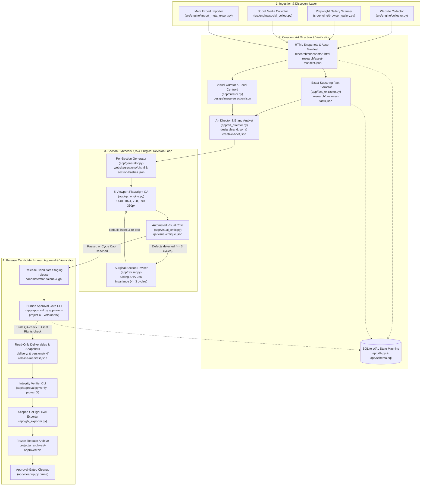
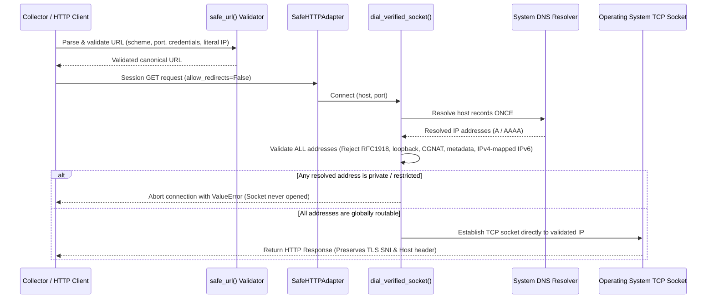
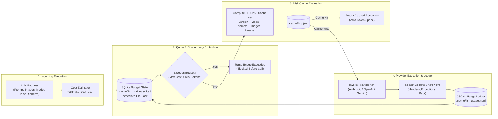

# Pet Grooming Website Builder Engine (`EditVista`)

[](https://github.com/rashidtesting8-ops/pet-gromming-agent-factory/actions/workflows/ci.yml)


**An evidence-preserving, local-first engine for automated media collection, cryptographic fact verification, visual curation, art direction, per-section code generation, surgical revision, 5-viewport QA, budget-capped LLM adaptation, and human-approved release packaging for bespoke pet grooming websites.**

---

## Table of Contents

1. [Project Overview](#1-project-overview)
2. [Key Features](#2-key-features)
3. [Architecture & System Design](#3-architecture--system-design)
4. [Technology Stack](#4-technology-stack)
5. [Project Structure](#5-project-structure)
6. [Prerequisites](#6-prerequisites)
7. [Installation & Setup](#7-installation--setup)
8. [Environment Configuration](#8-environment-configuration)
9. [Usage & CLI Reference](#9-usage--cli-reference)
10. [Local Worker API](#10-local-worker-api)
11. [Testing & Quality Assurance](#11-testing--quality-assurance)
12. [Deployment & Production Considerations](#12-deployment--production-considerations)
13. [Security Architecture](#13-security-architecture)
14. [Troubleshooting](#14-troubleshooting)
15. [Roadmap](#15-roadmap)
16. [Contributing & Definition of Done](#16-contributing--definition-of-done)
17. [License & Acknowledgments](#17-license--acknowledgments)

---

## 1. Project Overview

### Purpose
The **Pet Grooming Website Builder Engine (`EditVista`)** is an automated, modular Python pipeline engineered to transform public digital footprints of real pet grooming businesses (existing websites, Instagram/Facebook exports, and client media) into bespoke, accessible, responsive homepages. Every phase of execution—from SSRF-shielded crawling to exact-match fact extraction, focal-point curation, per-section HTML/CSS synthesis, 5-viewport Playwright QA, surgical DOM revision, and human-signed release freezing—is deterministically persisted, checksummed, and gated by automated invariants.

### Problem Statement
Traditional AI site generators suffer from critical production failure modes:
1. **Hallucination & Legal Liability**: Generative models frequently fabricate pricing tiers, invent non-existent services, synthesize fake customer testimonials, and incorporate unverified copyright assets.
2. **Security Vulnerabilities**: Naive web crawlers are vulnerable to Server-Side Request Forgery (SSRF), DNS-rebinding Time-Of-Check to Time-Of-Use (TOCTOU) exploits, internal cloud metadata exfiltration (`169.254.169.254`), and indirect prompt injection attacks hidden in scraped markup.
3. **Destructive Revisions**: AI revision cycles typically regenerate entire documents, destroying previously verified layout structures, shifting unrelated page elements, and corrupting functional code.
4. **Host Platform Conflicts**: Emitted CSS and JavaScript often leak into host environments (such as GoHighLevel page builders), breaking global layout containers, modal drawers, and styling rules.
5. **Runaway Compute Spend**: Unconstrained LLM integrations risk exponential spend and model timeout loops without persistent job budgeting or token accounting.

### Core Value Proposition & Engineering Invariants
- **Cryptographic Provenance & Zero Fabrication**: Every scraped webpage is archived to raw HTML snapshots keyed by SHA-256 (`research/snapshots/<sha256>.html`). Every extracted fact requires an exact substring match within the source snapshot; unverified claims or prices are automatically downgraded to `status="needs_review"` and rendered as custom quote inquiry CTAs rather than synthetic copy.
- **Defense-in-Depth Scraping Architecture**: A custom single-resolution socket dialer (`dial_verified_socket`) and scoped `SafeHTTPAdapter` validate all returned A/AAAA records before opening TCP connections, permanently blocking private RFC 1918, loopback, link-local, multicast, CGNAT, and cloud metadata subnets.
- **Per-Section File Modularization & Surgical Revisions**: The generator modularizes page output into discrete files under `website/sections/<name>.html` and `website/css/<name>.css`, assembling `website/index.html` strictly from section files. The reviser modifies **only** the target section, enforcing strict byte-for-byte SHA-256 preservation across all untouched sections and verified via automated Playwright pixel-invariance screenshot tests.
- **Hardened Multimodal LLM Adapter**: Provider-agnostic interface with multi-input caching (keyed by prompt, system prompt, temperature, max tokens, schema, adapter version, and image hashes), SQLite-persisted budget state per `project_id`, upfront cost estimation blocking calls before budget exhaustion, quota tracking for retries/timeouts, and automatic secret redaction.
- **Mandatory Human Approval Gate & Version Snapshots**: Release candidates are staged exclusively under `release-candidate/`. Approval requires human verification (`approve` CLI), stale-QA rejection via candidate SHA-256 matching, asset rights confirmation audits for every referenced HTML asset, and snapshot freezing into read-only `delivery/` and `versions/vN/` directories backed by `release-manifest.json`.
- **Pre-Export Release Verification**: Exporter and cleanup modules enforce automated integrity verification (`verify_release`) against `delivery/release-manifest.json`, blocking all exports and pruning if files have been tampered with or modified out-of-band.
- **Zero-Collision Host Embedding**: Emitted GoHighLevel deliverables (`delivery/ghl-ready.html`) are isolated under unique business root containers (`#ghl-ev-engine-root-[business_id]`), rewriting CSS custom properties and scoping JavaScript inside strict Immediately Invoked Function Expressions (IIFE) monitored by `MutationObserver`.

---

## 2. Key Features

| Domain | Module | Technical Capabilities & Invariants |
| :--- | :--- | :--- |
| **Resumable Master Orchestrator** | `app/pipeline.py` | Connects all 9 pipeline stages with SQLite idempotency keys (`{project_id}_{stage_name}_{input_manifest_hash}`), `--resume` stage skipping, `--pause-for-approval` human gate, and CLI subcommands (`approve`, `verify`, `prune`). |
| **SSRF & DNS-Rebinding Hardened Crawler** | `src/engine/collector.py` | Restricts crawls to same-site pages (`<= 40`), respects `robots.txt`, validates all resolved DNS IPs before connection, archives raw HTML snapshots, decomposes dangerous DOM nodes (`<script>`, `<style>`, `<iframe>`, `<svg>`), and strips prompt injection delimiters. |
| **Dynamic JS Gallery Discovery** | `src/engine/browser_gallery.py` | Spawns an ephemeral headless Chromium browser to scroll and render JavaScript-dependent image galleries, downloading discovered media through the SSRF-hardened network pipeline. |
| **Subprocess Social Media Collector** | `src/engine/social_collect.py` | Invokes `gallery-dl` in an isolated subprocess (`--config-ignore`, `--no-input`, `--sleep-request 3.0`), verifies post timestamps via `--dump-json` dry-runs, strips EXIF/GPS metadata, enforces storage limits, and classifies failures without crashing. |
| **Meta Archive Importer** | `src/engine/import_meta_export.py` | Ingests Instagram/Facebook "Download Your Information" ZIP archives or directories, repairs Latin-1/UTF-8 mojibake, enforces streaming ratio caps against zip bombs, and blocks directory traversal. |
| **Exact-Substring Fact Verification** | `app/fact_extractor.py` | Extracts business facts (phone, address, hours, services, prices) and matches them verbatim against crawled HTML snapshots (`research/business-facts.json`). Flagged or missing items default to `status="needs_review"`. |
| **Visual Curation & Focal-Point Detection** | `app/curator.py` | Scans candidate images using Pillow; excludes low-resolution files (`< 800px`) and baked-in text; computes upper-center pet focal percentages (`object-position`); enforces cross-section deduplication across `hero`, `gallery`, and `van` (`design/image-selection.json`). |
| **Brand Analysis & Art Direction** | `app/art_director.py` | Extracts dominant brand palettes from logos (with accessible pet-care fallback: `#1B365D` navy, `#D98A2B` amber, `#8FA998` sage); builds wireframe structures for salons vs. mobile groomers (`design/brand.json`, `design/creative-brief.json`). |
| **Per-Section Website Synthesis** | `app/generator.py` | Emits modular section files (`website/sections/<name>.html`, `website/css/<name>.css`, `website/section-hashes.json`); dynamically rebuilds `website/index.html` strictly from section files; renders accessible CTA inquiry fallbacks when pricing is unverified. |
| **Surgical Section Reviser & Security Validator** | `app/generator.py`, `app/reviser.py` | Validates section markup (rejects `<script>`, inline `on*` event handlers, external URLs/schemes, and files `> 500 KB`); patches targeted section on disk; recomputes section hashes; guarantees 100% SHA-256 preservation of untouched siblings. |
| **5-Viewport Playwright QA Engine** | `app/qa_engine.py`, `src/engine/local_preview.py` | Hosts an ephemeral HTTP server and runs automated audits across `1440px`, `1024px`, `768px`, `390px`, and `360px` viewports for horizontal overflow, 404 assets, console exceptions, broken images (`naturalWidth === 0`), and WCAG AA contrast. |
| **Visual Critic & Feedback Loop** | `app/visual_critic.py` | Evaluates layout and typography against pet grooming design rules (avoiding repetitive `#F5F5DC` cards, clipped hero headers, or awkward spacing), logging actionable defect items to `qa/visual-critique.json` (hard cap of 3 cycles). |
| **Hardened Multimodal LLM Adapter** | `src/engine/llm/adapter.py` | Multi-provider adapter (Anthropic, OpenAI, Gemini, Fake) with SHA-256 disk caching, SQLite-persisted project budget state, upfront cost estimation, call and token caps, retry tracking, path traversal defense, and automatic credential redaction. |
| **Human Approval & Release Candidate Gate** | `app/approval.py` | Pipeline stages candidate deliverables to `release-candidate/`; `approve` CLI checks QA candidate SHA-256 matching, audits referenced HTML assets for confirmed rights, freezes read-only files in `delivery/` and `versions/vN/`, and writes `release-manifest.json`. |
| **Release Verification & Scoped GHL Export** | `app/approval.py`, `src/engine/exporter.py`, `app/ghl_exporter.py` | Verifies delivery files against manifest checksums (`verify` CLI); packages verified releases into `projects/_archives/<id>-approved.zip`; formats GHL code snippets scoped under `#ghl-ev-engine-root-[business_id]`. |
| **Approval-Gated Safe Storage Pruning** | `app/cleanup.py`, `src/engine/cleanup.py` | Refuses pruning unless verified approved release archive exists and matches manifest; permanently protects `delivery/`, version snapshots, and `retained-assets.json`. |
| **Local FastAPI Worker Service** | `src/engine/service.py` | Bounded asynchronous task runner (`127.0.0.1:8787`) backed by SQLite WAL mode and concurrency semaphores (`4` queue slots, `2` execution threads) for self-hosted n8n workflow integration. |

---

## 3. Architecture & System Design

### 3.1 End-to-End Pipeline & Release State Machine



### 3.2 Network Defense & SSRF Mitigation Sequence



### 3.3 LLM Adapter Architecture & Budget Enforcement



---

## 4. Technology Stack

| Category | Technology | Constraint / Version | Purpose |
| :--- | :--- | :--- | :--- |
| **Language & Runtime** | Python | `>=3.12,<3.13` | Deterministic, modern Python execution runtime. |
| **Package Management** | `uv` / `hatchling` | `uv >= 0.9` | Dependency resolution, locked environments (`uv.lock`), and packaging. |
| **Data Contracts** | Pydantic v2 | `>=2.10` | Strict validation of stage manifests, asset provenance, facts, and LLM payloads. |
| **DOM Parsing & Scraping** | BeautifulSoup4, Requests | `bs4 >= 4.12`, `requests >= 2.31` | HTML parsing, DOM sanitization, CSS extraction, and section reconstruction. |
| **Image Analysis** | Pillow | `>=10,<13` | Sharpness calculation, focal-point centroids, EXIF stripping, contact sheets. |
| **Browser Engine** | Playwright Chromium | `==1.55.0` pinned | Dynamic gallery extraction and 5-viewport automated visual QA runner. |
| **Subprocess Ingestion** | `gallery-dl` | `==1.30.0` pinned | Subprocess-isolated media metadata extraction from public profiles. |
| **State Storage** | SQLite (`sqlite3`) | Standard Library (WAL) | Relational state machine, stage manifests, idempotency keys, LLM budget locks. |
| **HTTP Worker API** | FastAPI, Uvicorn | `fastapi >= 0.115`, `uvicorn >= 0.32` | Local loopback asynchronous job queue service (`127.0.0.1:8787`). |
| **Workflow Automation** | n8n (Self-Hosted) | `docker.n8n.io/n8nio/n8n:2.39.5` | Optional webhook-driven intake and status polling via Docker Compose. |
| **Static Verification** | Ruff, Pyright, Pytest | `ruff >= 0.9`, `pyright >= 1.1`, `pytest >= 8.3` | Linting, strict type-checking, and comprehensive 110-test test suite. |

---

## 5. Project Structure

```text
pet-gromming-agent-factory/
├── AGENTS.md                                # Non-negotiable domain rules, invariants & Definition of Done
├── pyproject.toml                           # Python 3.12 project metadata, dependencies & tool configuration
├── uv.lock                                  # Cryptographically pinned dependency lockfile
├── Dockerfile                               # Python 3.12-slim container definition for the collector API
├── docker-compose.yml                       # Multi-container orchestration (n8n + collector bound to 127.0.0.1)
├── Makefile / justfile                      # Task shortcuts for linting, type-checking, and test execution
├── requirements.txt                         # Pinned core pip dependencies
├── requirements-browser.txt                 # Optional browser automation pin (playwright==1.55.0)
├── requirements-social.txt                  # Optional social media collector pin (gallery-dl==1.30.0)
├── docs/
│   ├── DEVELOPER_BRIEF.md                   # Full architectural specification, rules & milestone roadmaps
│   ├── AUDIT_AND_TESTS.md                   # Security audit logs and collector penetration test details
│   └── BUDGET_AND_QUALITY.md                # Spend controls, storage limits, and QA threshold metrics
├── examples/
│   └── BUSINESS_INPUT_EXAMPLE.json          # Reference JSON schema for business intake workflows
├── n8n/
│   ├── 01-submit-asset-research.json        # Intake webhook workflow for submitting collection jobs
│   └── 02-check-asset-job.json              # Polling workflow for monitoring job execution status
├── src/engine/
│   ├── __init__.py
│   ├── contracts/
│   │   └── __init__.py                      # Pydantic v2 domain schemas (StageInput, StageOutput, Asset, Claim)
│   ├── collector.py                         # SSRF-shielded web crawler, HTML sanitizer & snapshot archiver
│   ├── browser_gallery.py                   # Headless Playwright dynamic gallery discovery runner
│   ├── social_collect.py                    # Subprocess-isolated gallery-dl runner with EXIF stripping
│   ├── import_meta_export.py                # Meta "Download your information" parser with zip-bomb guards
│   ├── contact_sheet.py                     # Visual contact sheet compositor for media review
│   ├── local_preview.py                     # Static + Playwright local preview server and bad link auditor
│   ├── exporter.py                          # Release gate exporter verifying asset rights and release integrity
│   ├── cleanup.py                           # Approval-gated safe storage pruner and archive builder
│   ├── service.py                           # FastAPI + SQLite worker service for n8n orchestration
│   └── llm/
│       ├── __init__.py                      # LLM module public interface exports
│       └── adapter.py                       # Hardened provider-agnostic adapter, budget engine & secret redactor
├── app/
│   ├── schema.sql                           # SQLite relational schema (projects, job_runs, facts, provenance)
│   ├── db.py                                # SQLite WAL connection factory, BEGIN IMMEDIATE transactions & models
│   ├── fact_extractor.py                    # Exact-substring fact extractor writing research/business-facts.json
│   ├── curator.py                           # Pillow-based visual curator writing design/image-selection.json
│   ├── art_director.py                      # Brand palette extractor & wireframe builder (brand.json, creative-brief.json)
│   ├── generator.py                         # Per-section HTML/CSS generator, index rebuilder & security validator
│   ├── qa_engine.py                         # 5-viewport Playwright automated QA runner (1440, 1024, 768, 390, 360px)
│   ├── visual_critic.py                     # Visual layout and contrast critic writing qa/visual-critique.json
│   ├── reviser.py                           # Surgical section-level reviser enforcing sibling SHA-256 invariance
│   ├── approval.py                          # Human approval gate CLI, release-manifest freeze & release verifier
│   ├── ghl_exporter.py                      # Scoped GoHighLevel custom code exporter (#ghl-ev-engine-root-*)
│   ├── pipeline.py                          # Master resumable CLI pipeline orchestrator & subcommand router
│   └── cleanup.py                           # High-level wrapper for safe_prune_project()
└── tests/
    ├── test_ssrf_rebinding.py               # 28 SSRF, IP literal, cloud metadata & DNS rebinding tests
    ├── test_llm_adapter.py                  # 11 LLM caching, budget persistence, cost estimation & redaction tests
    ├── test_contracts.py                    # 10 Pydantic v2 stage contract and timezone validation tests
    ├── test_social_collect.py               # 10 gallery-dl permission, EXIF stripping & failure classification tests
    ├── test_approval_archival.py            # 7 Approval gate, stale QA, asset rights audit & verify tests
    ├── test_section_generator_and_reviser.py# 5 Section output, index rebuild, validation & Playwright pixel tests
    ├── test_collector.py                    # 5 Local crawl, snapshot hashing, sanitization & prompt injection tests
    ├── test_exporter_release_gate.py        # 4 Asset rights verification and release gate refusal tests
    ├── test_ghl_export.py                   # 4 GHL CSS scoping, root variable isolation & JS leakage tests
    ├── test_v2.py                           # 4 Domain spoofing, retention manifests & date cutoff regression tests
    ├── test_critic_and_reviser.py           # 3 Actionable visual defects, sibling SHA-256 invariance & loop cap tests
    ├── test_curator_art_director.py         # 3 Low-res exclusion, focal coordinates & wireframe taxonomy tests
    ├── test_db_concurrency.py               # 3 SQLite WAL pragmas, CRUD operations & 10-thread concurrency tests
    ├── test_import_meta_export.py           # 3 Meta export parsing, zip-bomb streaming caps & path traversal tests
    ├── test_local_preview.py                # 3 Placeholder CTA link detection, mobile menu & reduced-motion tests
    ├── test_qa_engine.py                    # 3 WCAG AA contrast math, 5-viewport inspection & teardown tests
    ├── test_pipeline_e2e.py                 # 2 End-to-end HTTP pipeline runs with unverified pricing fallback tests
    └── test_pipeline_lifecycle.py           # 2 Crash recovery (--resume), approval pause & CLI subcommand tests
```

---

## 6. Prerequisites

- **Python Runtime**: Python `3.12.x` strictly required (`>=3.12,<3.13` enforced by `pyproject.toml`).
- **Package Manager**: [`uv`](https://docs.astral.sh/uv/) (strongly recommended for deterministic lockfile synchronization) or `pip` / `venv`.
- **Operating System**: Linux (Ubuntu 22.04+), macOS (13+), or Windows (10/11 with PowerShell).
- **SQLite**: Built into Python standard library (`sqlite3`). WAL mode requires local POSIX or NTFS storage.
- **Optional External Tools**:
  - **Playwright Chromium**: Required for live 5-viewport QA audits and dynamic JS gallery extraction.
  - **`gallery-dl`**: Required only if executing live subprocess social media collection.
  - **Docker Engine & Compose**: Required only when running the containerized n8n and API service stack.

---

## 7. Installation & Setup

### Option 1: Standard Installation using `uv` (Recommended)

```bash
# 1. Clone the repository
git clone https://github.com/rashidtesting8-ops/pet-gromming-agent-factory.git
cd pet-gromming-agent-factory

# 2. Pin and install the Python 3.12 virtual environment
uv python install 3.12
uv sync --frozen --dev

# 3. (Optional) Install Playwright Chromium for automated QA and dynamic galleries
uv pip install -r requirements-browser.txt
uv run playwright install chromium

# 4. (Optional) Install gallery-dl for public social media collection
uv pip install -r requirements-social.txt
```

### Option 2: Installation using Standard `venv` + `pip`

```bash
# 1. Create a Python 3.12 virtual environment
python3.12 -m venv .venv

# 2. Activate virtual environment
# Linux / macOS:
source .venv/bin/activate
# Windows PowerShell:
.venv\Scripts\Activate.ps1

# 3. Install core dependencies
pip install -r requirements.txt
```

### Initializing the SQLite Database Schema

The SQLite database initializes automatically when running any pipeline or service operation. To explicitly initialize or inspect the schema programmatically:

```python
from pathlib import Path
from app.db import connect_db, init_db

db_path = Path("./projects/editvista.sqlite3")
conn = connect_db(db_path)
try:
    init_db(conn)  # Applies app/schema.sql inside an immediate transaction
finally:
    conn.close()
```

---

## 8. Environment Configuration

The engine is engineered to run locally without external cloud dependencies. Optional external LLM providers and container services are configured via environment variables:

| Variable | Type | Default | Description |
| :--- | :---: | :---: | :--- |
| `PROJECTS_DIR` | Path | `./projects` | Filesystem root where business workspaces, snapshots, and releases are saved. |
| `ANTHROPIC_API_KEY` | Secret | *None* | Optional API key for Anthropic Claude provider in `LLMAdapter`. |
| `OPENAI_API_KEY` | Secret | *None* | Optional API key for OpenAI provider in `LLMAdapter`. |
| `GEMINI_API_KEY` | Secret | *None* | Optional API key for Google Gemini provider in `LLMAdapter`. |
| `N8N_IMAGE` | String | `docker.n8n.io/n8nio/n8n:2.39.5` | Docker image tag for the self-hosted n8n orchestrator. |
| `GENERIC_TIMEZONE` | String | `Asia/Karachi` | Timezone configured for containerized n8n workflow execution. |
| `TZ` | String | `Asia/Karachi` | Local system timezone inside Docker containers. |

> [!IMPORTANT]
> API keys are read exclusively from environment variables at execution time. The engine strictly redacts all credentials from exception logs, HTTP request headers, and string representations, and never prints or writes keys to disk.

---

## 9. Usage & CLI Reference

### 9.1 End-to-End Master Pipeline (`app/pipeline.py`)

The pipeline runs through all 9 stages (`collect` $\rightarrow$ `extract` $\rightarrow$ `curate` $\rightarrow$ `art_director` $\rightarrow$ `generate` $\rightarrow$ `qa` $\rightarrow$ `critique` $\rightarrow$ `revise` $\rightarrow$ `stage_candidate`), stopping at the human approval gate:

```bash
# 1. Run pipeline and pause at human approval gate (default behavior)
uv run python -m app.pipeline \
  --url https://puppalacesalon.com \
  --name "Pup Palace Salon" \
  --business-id pup-palace

# 2. Resume an interrupted build (skips already completed stages using SQLite idempotency keys)
uv run python -m app.pipeline \
  --url https://puppalacesalon.com \
  --name "Pup Palace Salon" \
  --business-id pup-palace \
  --resume
```

### 9.2 Human Approval, Release Freezing & Verification

Deliverables are staged under `release-candidate/` and cannot be deployed until approved by a human operator:

```bash
# 1. Approve release candidate, freeze delivery/ & versions/v1/, and write release-manifest.json
uv run python -m app.pipeline approve \
  --project pup-palace \
  --version v1 \
  --operator "Rashid" \
  --notes "Verified 5-viewport QA, pricing inquiry CTAs, and asset copyright"

# 2. Verify deliverable integrity (re-hashes delivery/ against release-manifest.json)
uv run python -m app.pipeline verify --project pup-palace

# 3. Run approval-gated storage cleanup (prunes raw staging files while preserving release archive)
uv run python -m app.pipeline prune --project-id pup-palace
uv run python -m app.pipeline prune --project-id pup-palace --execute
```

### 9.3 Surgical Section Revision (Programmatic & CLI)

The revision engine validates markup safety and updates target sections without modifying untouched siblings:

```python
from pathlib import Path
from app.generator import revise_section

project_dir = Path("./projects/pup-palace")

new_hero_html = """
<section id="hero" class="ev-hero" data-section="hero">
  <div class="ev-hero-content">
    <h1 class="ev-hero-title">Royal Canine Styling & Spa</h1>
    <p class="ev-hero-subtitle">Award-winning, compassionate pet grooming.</p>
    <a class="cta btn" href="#contact">Book Appointment</a>
  </div>
</section>
"""

# Validates markup, updates website/sections/hero.html, rebuilds index.html, updates hashes
updated_hashes = revise_section("hero", new_hero_html, project_folder=project_dir)
print("Updated Hero SHA-256:", updated_hashes["hero"])
```

### 9.4 Hardened Multimodal LLM Adapter

```python
from pathlib import Path
from src.engine.llm import LLMAdapter, BudgetConfig, FakeProvider, ImageInput

# Initialize adapter with budget caps ($5 max, 20 calls max)
config = BudgetConfig(
    max_cost_usd=5.0,
    max_calls_per_job=20,
    cache_dir=Path(".cache/llm"),
)
adapter = LLMAdapter(provider=FakeProvider(default_response="Bespoke Pet Styling"), config=config)

response = adapter.complete(
    prompt="Generate an engaging headline for a luxury dog spa.",
    project_id="pup-palace",
    stage="art_direction",
    temperature=0.2,
)

print(response.content)
print(f"Tokens spent: {response.total_tokens}, Cached: {response.cached}")
```

### 9.5 Individual Stage CLI Execution

#### Web Scraping & Exact-Substring Fact Extraction
```bash
# Collect website pages and extract media
uv run python -m app.collector https://puppalacesalon.com \
  --output ./projects \
  --max-pages 25 \
  --max-media 80

# Extract and verify business facts
uv run python -c "from pathlib import Path; from app.fact_extractor import extract_business_facts; r = extract_business_facts(Path('./projects/puppalacesalon-com')); print(f'Extracted {len(r.facts)} facts')"
```

#### Public Social Media Collection & Meta Export Ingestion
```bash
# Subprocess gallery-dl collector (explicit permission flag mandatory)
uv run python -m app.social_collect \
  --project ./projects/pup-palace \
  --platform instagram \
  --url https://www.instagram.com/puppalacesalon/ \
  --max-files 40 \
  --days 365 \
  --i-have-permission

# Ingest Meta "Download Your Information" ZIP export
uv run python -m app.import_meta_export \
  --project ./projects/pup-palace \
  --export ./exports/instagram-data.zip \
  --platform auto \
  --max-files 80
```

#### Automated 5-Viewport Playwright QA
```bash
uv run python -m app.qa_engine \
  --project ./projects/pup-palace \
  --html website/index.html
```

---

## 10. Local Worker API

The engine includes a lightweight, loopback-bound FastAPI service ([`src/engine/service.py`](src/engine/service.py)) for integration with orchestration engines (such as n8n):

### Start the Worker Service
```bash
uv run uvicorn app.service:app --host 127.0.0.1 --port 8787
```

### Endpoints

#### `GET /health`
- **Purpose**: Liveness and readiness health probe.
- **Response (`200 OK`)**:
  ```json
  {
    "ok": true
  }
  ```

#### `POST /jobs`
- **Purpose**: Validate target URL via `safe_url()` and enqueue an asynchronous research collection job.
- **Request Body (`application/json`)**:
  ```json
  {
    "url": "https://puppalacesalon.com",
    "max_pages": 25,
    "max_media": 80
  }
  ```
- **Response (`202 Accepted`)**:
  ```json
  {
    "job_id": "8f3b2a1c4e7d4c3b8a1f0e9d8c7b6a5f",
    "status": "queued"
  }
  ```

#### `GET /jobs/{job_id}`
- **Purpose**: Fetch the real-time execution status and result summary from SQLite.
- **Response (`200 OK`)**:
  ```json
  {
    "job_id": "8f3b2a1c4e7d4c3b8a1f0e9d8c7b6a5f",
    "status": "done",
    "result": {
      "site_url": "https://puppalacesalon.com",
      "pages_crawled": 5,
      "assets_saved": 18,
      "project_folder": "projects/puppalacesalon-com"
    }
  }
  ```

---

## 11. Testing & Quality Assurance

The codebase is governed by a strict Definition of Done enforced via `ruff`, `pyright`, and `pytest`:

```bash
# Run linting, static type analysis, and all 110 automated tests
uv run ruff check . && uv run pyright && uv run pytest -v
```

Or using `make` / `just`:

```bash
make lint        # uv run ruff check .
make typecheck   # uv run pyright
make test        # uv run pytest
```

### Complete Test Suite Breakdown (110 Tests Across 18 Modules)

| Test Module | Tests | Test Objectives & Invariant Coverage |
| :--- | :---: | :--- |
| `tests/test_ssrf_rebinding.py` | 28 | Comprehensive network attack testing: RFC 1918 private IPs, loopback (`127.0.0.1`, `::1`), link-local / cloud metadata (`169.254.169.254`), CGNAT (`100.64.0.0/10`), IPv4-mapped IPv6, integer/octal/hex IP literals, redirect blocking, multi-record DNS rejection, and single-resolution DNS rebinding TOCTOU defense. |
| `tests/test_llm_adapter.py` | 11 | Multimodal LLM adapter verification: SHA-256 disk cache hits with text and images, SQLite budget persistence surviving restarts, upfront cost estimation blocking before spending, retry tracking against call caps, secret redaction, and path traversal rejection for image inputs. |
| `tests/test_contracts.py` | 10 | Pydantic v2 contract integrity: `StageInput`, `StageOutput`, `Asset`, `Claim`, timezone-aware UTC datetime enforcement, non-empty source text verification, and `rights_confirmed_for_preview=False` defaults. |
| `tests/test_social_collect.py` | 10 | Subprocess social collection: `--i-have-permission` flag enforcement, dry-run `--dump-json` post timestamp verification, EXIF/GPS metadata stripping, corrupt image rejection, and non-crashing failure classification (`login_required`, `rate_limited`, `extractor_broken`, `unknown`). |
| `tests/test_approval_archival.py` | 7 | Approval release gate: blocks export on critical QA defects or unconfirmed asset rights; stale QA rejection via candidate SHA-256 matching; read-only release freeze in `delivery/` and `versions/vN/`; release manifest verification; and immunity of delivery files during cleanup. |
| `tests/test_section_generator_and_reviser.py` | 5 | Section-based synthesis: per-section file generation; index rebuilding from section files; markup security validation (rejects `<script>`, inline handlers, external URLs, oversized payloads); and 1440px / 390px Playwright pixel-invariance screenshot tests. |
| `tests/test_collector.py` | 5 | Web crawler verification: local HTTP crawl, HTML snapshot SHA-256 verification, stripping of executable DOM nodes, prompt injection neutralization, and exact-substring fact extraction. |
| `tests/test_exporter_release_gate.py` | 4 | Release packaging: ensures `export_approved_deliverables()` blocks when `delivery/` is unverified or any referenced asset lacks confirmed preview rights; generates deliverable bundles when all assets are confirmed. |
| `tests/test_ghl_export.py` | 4 | GoHighLevel encapsulation: `#ghl-ev-engine-root-*` CSS scoping, `:root` variable rewriting, HTML body extraction, IIFE + `MutationObserver` JS encapsulation, and global `window.*` / `document.*` leakage rejection. |
| `tests/test_v2.py` | 4 | Regression suite: prevents social media domain spoofing, validates leap-year date boundary cutoffs, enforces retention manifest path-traversal blocks, and verifies archive/prune workflows. |
| `tests/test_critic_and_reviser.py` | 3 | Design quality: automated visual critic defect detection, rejection of vague feedback (`"make it better"`), byte-identical sibling section preservation, and 3-iteration revision loop ceiling. |
| `tests/test_curator_art_director.py` | 3 | Visual curation: filters out low-resolution images (`< 800px`) and baked-in promotional text; validates CSS focal percentages; extracts brand palettes; builds wireframes for mobile vs. salon groomers. |
| `tests/test_db_concurrency.py` | 3 | Database concurrency: verifies SQLite PRAGMA configuration (`WAL`, `busy_timeout=5000`), Pydantic CRUD transactions, and executes 10 concurrent threads writing 15 `BEGIN IMMEDIATE` transactions each with zero lock failures. |
| `tests/test_import_meta_export.py` | 3 | Meta data ingestion: handles Instagram and Facebook exports across schema versions, deduplicates assets by SHA-256, enforces streaming ratio caps against zip bombs, and blocks `../` path traversal. |
| `tests/test_local_preview.py` | 3 | Static QA validation: detects placeholder links (`#`, `javascript:`, empty CTAs), audits mobile menu toggling, and checks `prefers-reduced-motion` compliance. |
| `tests/test_qa_engine.py` | 3 | 5-viewport Playwright runner: verifies WCAG 2.1 AA contrast mathematics, multi-viewport layout rendering, automated defect logging, and deterministic resource teardown. |
| `tests/test_pipeline_e2e.py` | 2 | End-to-end integration: full pipeline execution against an ephemeral grooming salon HTTP server, verifying inquiry CTA fallbacks when pricing is unverified. |
| `tests/test_pipeline_lifecycle.py` | 2 | Crash recovery and state lifecycle: simulated mid-run pipeline crashes, `--resume` stage skipping, and `--pause-for-approval` human approval gate execution. |

---

## 12. Deployment & Production Considerations

### Containerized Orchestration (`docker-compose.yml`)
The repository includes a production-tested Compose configuration running two resource-isolated services bound strictly to loopback:
- **`n8n`** (`127.0.0.1:5678`, `mem_limit: 1g`): Self-hosted workflow automation engine with state persisted in the `n8n_data` named volume.
- **`collector`** (`127.0.0.1:8787`, `mem_limit: 512m`): Containerized FastAPI collector service mounting local `./projects` to `/data/projects`.

```bash
# Build and run containerized services in background
docker compose up --build -d

# View real-time service logs
docker compose logs -f collector
```

### Filesystem & Operational Limits
- **Storage Ceilings**: Web collection is capped at `140 MB` (`MAX_SITE_BYTES`); social staging is capped at `150 MB` (`MAX_STAGING_BYTES`), `25 MB` per file (`MAX_ITEM_BYTES`), and `300 MB` total project size (`MAX_PROJECT_BYTES`).
- **SQLite Placement**: Keep SQLite database files (`jobs.sqlite`, `editvista.sqlite3`, `llm_budget.sqlite3`) on local POSIX or NTFS drives. **Never** place SQLite WAL files on NFS or SMB network mounts, where network locking semantics can corrupt shared memory (`-shm`) index files.

---

## 13. Security Architecture

1. **Zero Credential Harvesting or Identity Spoofing**: The engine never requests client passwords, never collects user authentication tokens, never bypasses CAPTCHAs, and never rotates fake proxy identities.
2. **SSRF & DNS-Rebinding Hardening**: All outbound HTTP calls pass through `dial_verified_socket`. DNS resolution happens once, validating that every resolved IP is globally routable before socket establishment. Redirects are evaluated per-hop against the same dialer.
3. **Data/Instruction Separation & Prompt Injection Defense**: Scraped HTML text, social captions, and client-provided metadata are treated strictly as untrusted data, never as executable instructions. Parsing strips executable tags (`script`, `style`, `iframe`, `object`, `svg`) and neutralizes prompt injection delimiters before downstream processing.
4. **Section Revision Markup Sanitization**: `validate_section_html()` inspects all revised section markup, strictly prohibiting `<script>` tags, inline event attributes (`onclick`, `onerror`), external URLs (`http://`, `https://`, `//`), unsafe URI schemes (`javascript:`, `data:`), and files exceeding `500 KB`.
5. **Path Traversal & Zip-Bomb Defense**: Archive extractors resolve canonical file paths and verify `Path.is_relative_to(target_dir)`, rejecting symlinks, absolute paths, and `../` segments while enforcing uncompressed ratio limits.
6. **Metadata Privacy (EXIF Sanitization)**: Downloaded and imported images are re-encoded via `strip_image_metadata()` into `assets/optimized/`, stripping all EXIF GPS coordinate tags and camera metadata before publication.
7. **Secret Redaction**: `LLMAdapter` scans headers, exceptions, and string representations to redact sensitive API keys and secrets before logging or raising errors.

---

## 14. Troubleshooting

| Symptom / Error | Root Cause | Verified Resolution |
| :--- | :--- | :--- |
| `status: "review_needed", reason: "permission_required"` | `social_collect.py` invoked without explicit permission confirmation. | Pass `--i-have-permission` on CLI or `i_have_permission=True` in Python after confirming client permission. |
| `status: "review_needed", reason: "gallery_dl_not_installed"` | Optional `gallery-dl` package is missing. | Run `uv pip install -r requirements-social.txt`. |
| `ReleaseApprovalGateError: Deliverable export is locked` | Deliverables called before human approval. | Run `uv run python -m app.pipeline approve --project <ID> --version v1 --operator "<Name>"`. |
| `ValueError: Stale QA report: SHA-256 ... does not match current candidate` | Site modified after QA was run. | Re-run QA via `uv run python -m app.qa_engine --project <ID>` before approving. |
| `ValueError: Pruning is strictly BLOCKED: verified archive ... does not exist` | Cleanup executed before freezing an approved release. | Approve the release and verify the archive with `app.pipeline approve` before running `prune`. |
| `status: "blocked_unconfirmed_rights"` in `exporter.py` | Referenced HTML assets have `rights_confirmed_for_preview=False`. | Review `result["offending_assets"]`, verify client consent, and set `rights_confirmed_for_preview=True` in the manifest. |
| `BudgetExceeded: Cost estimate ... exceeds maximum budget` | Projected LLM call cost exceeds configured `max_cost_usd`. | Adjust `BudgetConfig.max_cost_usd` or choose a more cost-effective model in the price table. |
| `GlobalLeakageError` in `ghl_exporter.py` | JavaScript assigns properties directly to `window.*` or `document.*`. | Keep JavaScript state strictly within local variables scoped to the container's IIFE. |
| `RuntimeError: Install requirements-browser.txt and Chromium` | Playwright or Chromium binary missing. | Run `uv pip install -r requirements-browser.txt && uv run playwright install chromium`. |

---

## 15. Roadmap

Per [`docs/DEVELOPER_BRIEF.md`](docs/DEVELOPER_BRIEF.md), development follows five sequential milestones:

- [x] **Milestone 1 — Collect & Prove Provenance**: SSRF-hardened crawler, HTML snapshot archiving, `gallery-dl` subprocess wrapper, Meta export importer, contact sheet generator, and SQLite WAL data layer.
- [x] **Milestone 2 — Visual & Content Intelligence**: Exact-substring fact extractor (`app/fact_extractor.py`), Pillow-based visual curator (`app/curator.py`), brand analyst & art director (`app/art_director.py`), and Pydantic v2 domain schemas (`src/engine/contracts/`).
- [x] **Milestone 3 — Design, Critique, QA & Surgical Revision Loop**: Per-section website generator (`app/generator.py`), 5-viewport Playwright QA runner (`app/qa_engine.py`), automated visual critic (`app/visual_critic.py`), and surgical section reviser (`app/reviser.py`) with sibling SHA-256 invariance.
- [x] **Milestone 4 — Human Approval, Frozen Release Export & Hardened LLM Engine**: Resumable pipeline orchestrator (`app/pipeline.py`), human approval gate CLI (`app/approval.py approve`), pre-export release verifier (`app/pipeline.py verify`), scoped GoHighLevel exporter (`app/ghl_exporter.py`), approval-gated cleanup (`app/cleanup.py`), and hardened multimodal LLM adapter (`src/engine/llm/adapter.py`).
- [ ] **Milestone 5 — Five-Business Acceptance Pilot**: End-to-end field testing across five live pet grooming businesses (salon, mobile van, daycare) with live GoHighLevel embed verification and multimodal LLM benchmark evaluations.

---

## 16. Contributing & Definition of Done

All contributions must adhere strictly to [`AGENTS.md`](AGENTS.md) and [`docs/DEVELOPER_BRIEF.md`](docs/DEVELOPER_BRIEF.md):

1. **Non-Negotiable Zero Fabrication**: Never invent business facts, prices, testimonials, or staff photos. Unsupported copy must default to `status="needs_review"`.
2. **Test-Driven Development (TDD)**: Write a failing test in `tests/` first, verify its failure, then implement the minimal code required to pass.
3. **No Unapproved Dependencies**: Do not introduce new dependencies into `pyproject.toml` without version pinning and explicit justification.
4. **Atomic Filesystem Writes**: Always write manifests, deliverables, and snapshots using temporary files in the target directory followed by atomic replacement (`os.replace`).
5. **Mandatory Quality Gate Verification**: Before committing, execute and report zero errors from all three static analysis tools:
   ```bash
   uv run ruff check . && uv run pyright && uv run pytest
   ```

---

## 17. License & Acknowledgments

- **License**: Internal / Proprietary — Prototype and testing engine for **EditVista** (not licensed for unauthorized public distribution; see [`AGENTS.md`](AGENTS.md)).
- **Acknowledgments**: Built with Python 3.12, [FastAPI](https://fastapi.tiangolo.com/), [Pydantic v2](https://docs.pydantic.dev/), [BeautifulSoup4](https://www.crummy.com/software/BeautifulSoup/), [Pillow](https://python-pillow.org/), [Playwright](https://playwright.dev/python/), [gallery-dl](https://github.com/mikf/gallery-dl), [n8n](https://n8n.io/), and [uv](https://docs.astral.sh/uv/).
